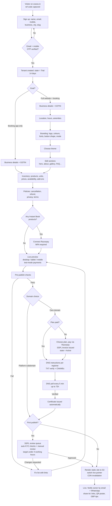
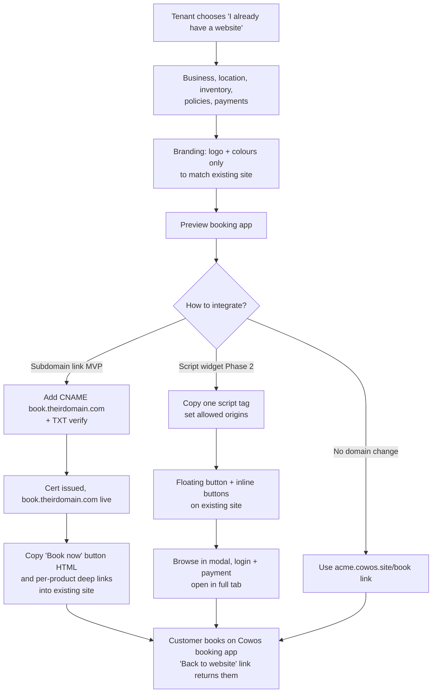
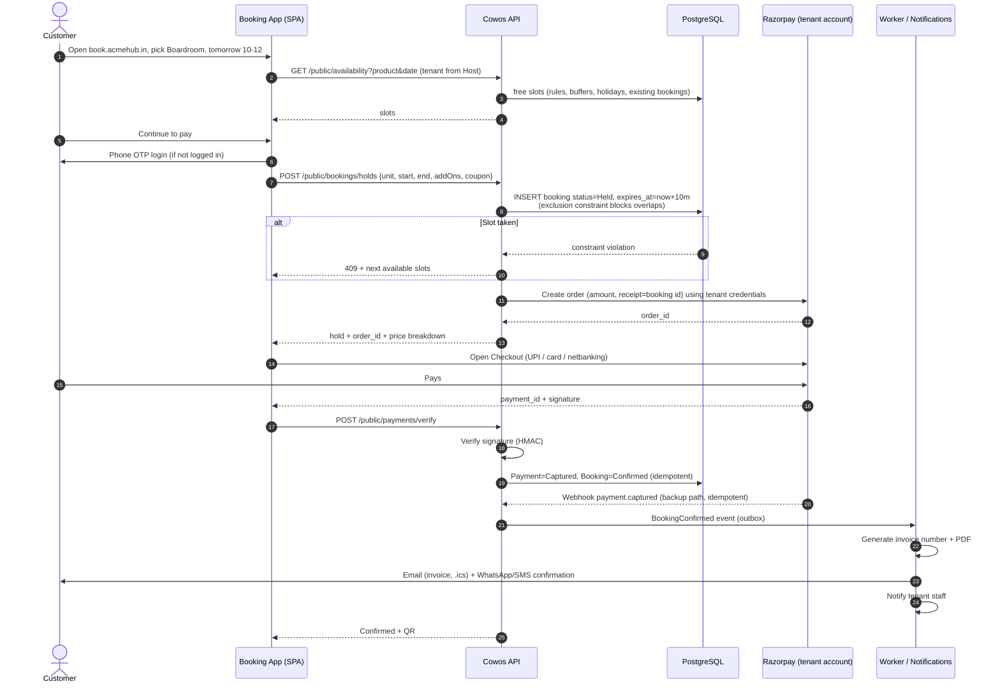
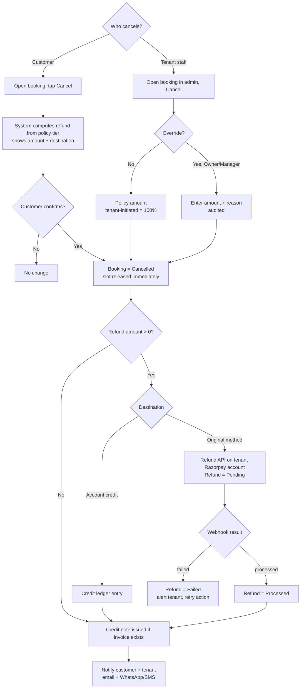
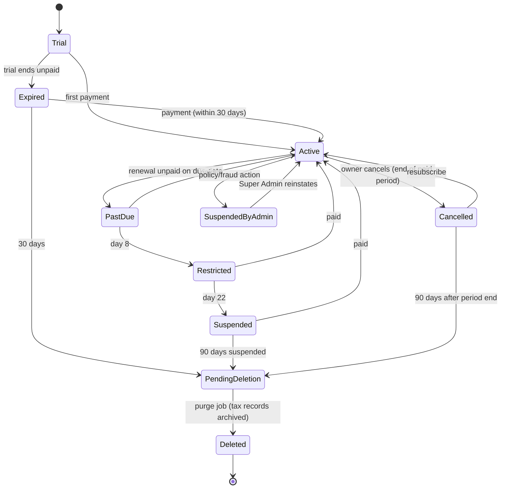
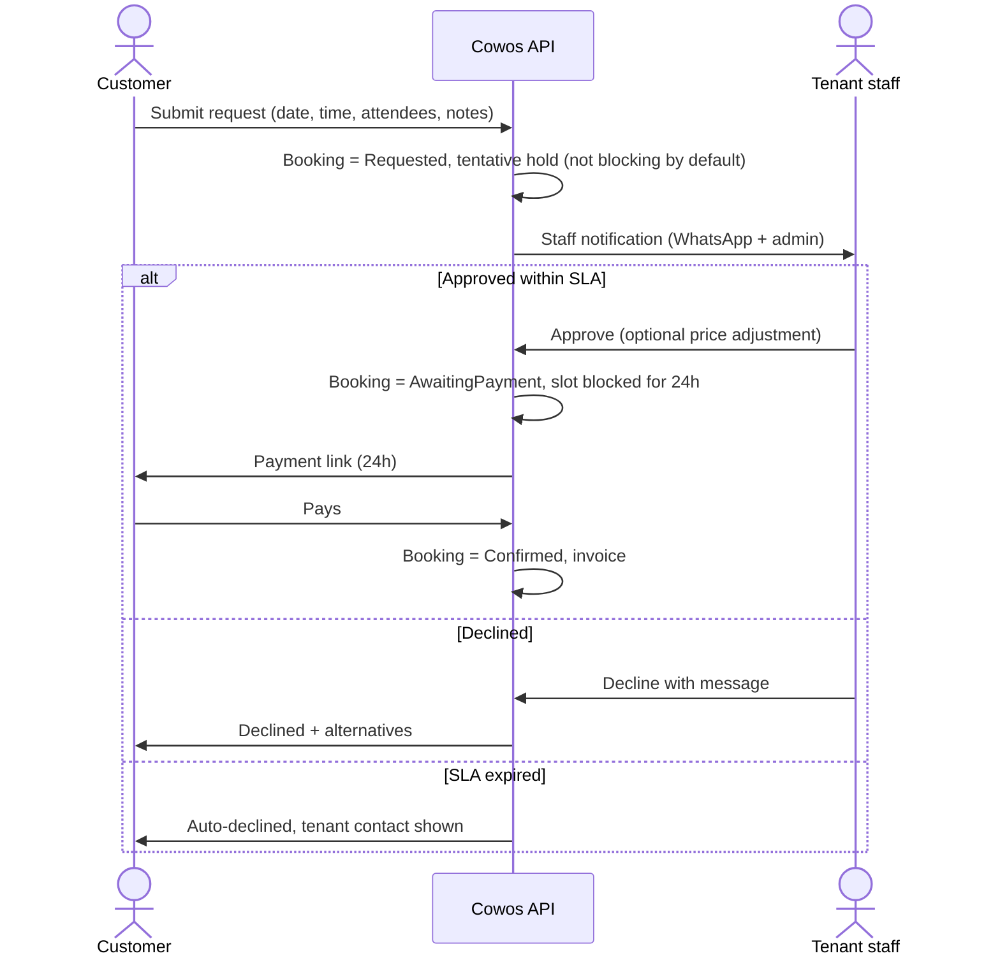
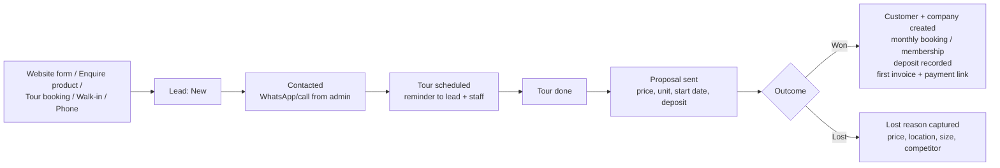

# 06 · Key User Flows

> Cowos requirements pack · v0.1 draft · Diagrams are Mermaid (render on GitHub and in most Markdown viewers).

## Flow 1 · Tenant registration → build → preview → pay → publish

Key rules:
- Trial tenants can publish to the platform subdomain (marked `noindex` until paid). Payment is required before a custom domain goes live, and before the trial ends.
- If you want strict "pay before any publish" (as in the original brief), set the platform flag `require_payment_before_first_publish = true`. Recommendation: keep it off, because a live site during the trial is the strongest conversion driver.
- Domain verification runs in the background. The tenant can publish on the platform subdomain while waiting.

## Flow 2 · Existing-website integration (booking app only)

## Flow 3 · Customer booking → payment → confirmation (Instant Book)

Edge cases handled:
| Case | Behaviour |
|------|-----------|
| Customer closes the browser after paying | Webhook confirms the booking; customer gets notifications anyway |
| Hold expires during payment, slot still free | Late capture confirms the booking |
| Hold expires, slot taken by someone else, payment captured | Automatic full refund + apology notification with alternatives |
| Payment fails | Hold released immediately; customer can retry with a new hold |
| Webhook arrives before client verify | Same idempotency key (gateway payment id); second call is a no-op |
| Tenant in `Restricted` state | Hold creation refused with "Online booking paused, call/WhatsApp <tenant>" |

## Flow 4 · Cancellation and refund

Notes:
- Refunds come from the tenant's Razorpay balance. If the tenant's balance is insufficient, Razorpay may fail or queue the refund; the tenant gets a clear alert.
- Gateway fees are not returned by Razorpay. Whether the customer refund deducts them is a tenant policy setting and is shown in the policy text.
- Monthly bookings and memberships don't use this flow; they follow notice-period rules handled by staff (Phase 2 automates it).

## Flow 5 · Tenant payment lapse → restriction → suspension → deletion

What each state allows:

| State | Website | Booking app: new bookings | Booking app: existing customers | Tenant admin | Notifications |
|-------|---------|--------------------------|-------------------------------|--------------|---------------|
| Trial | Live on platform subdomain (`noindex`) | Yes | Yes | Full (custom domain locked) | Day 10–14 reminders |
| Active | Live | Yes | Yes | Full | Renewal reminders −7d, −1d |
| PastDue (days 0–7) | Live | Yes | Yes | Full + banner | Daily |
| Restricted (days 8–21) | Live | **No**: "Online booking paused, contact <tenant>" | View, cancel, invoices | Read-only + billing, exports, booking management | Every 2 days |
| Suspended (day 22+) | Neutral "temporarily unavailable" page with tenant contacts | No | View bookings, download invoices | Billing, export, cancel only | Day 30, 60, 80 |
| Expired (trial unpaid) | Offline | No | View | Billing + export | Day 1, 7, 25 |
| Cancelled | Live until period end, then as Suspended | Until period end | Yes | Until period end, then billing/export | Export reminders |
| SuspendedByAdmin | Offline (generic page) | No | No | Owner can see the reason and contact SSPL | Immediate |
| PendingDeletion → Deleted | Offline, DNS mapping removed | No | No | No | Final notice 7 days before purge |

## Flow 6 · Request to Book (event space)

## Flow 7 · Lead → tour → membership (sales-led cabins and dedicated desks)

