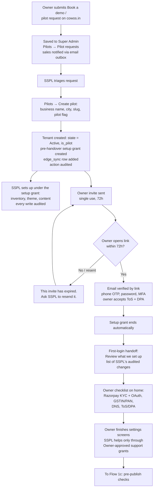
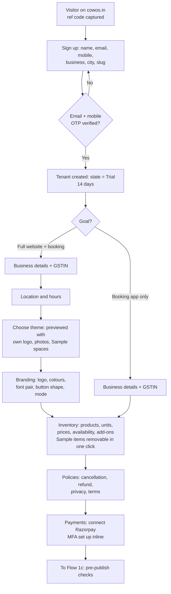
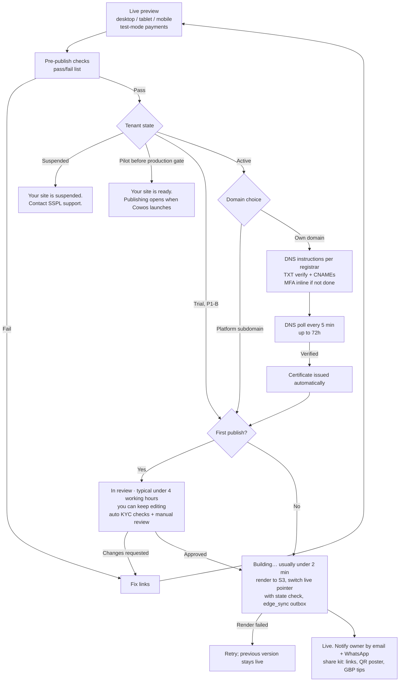
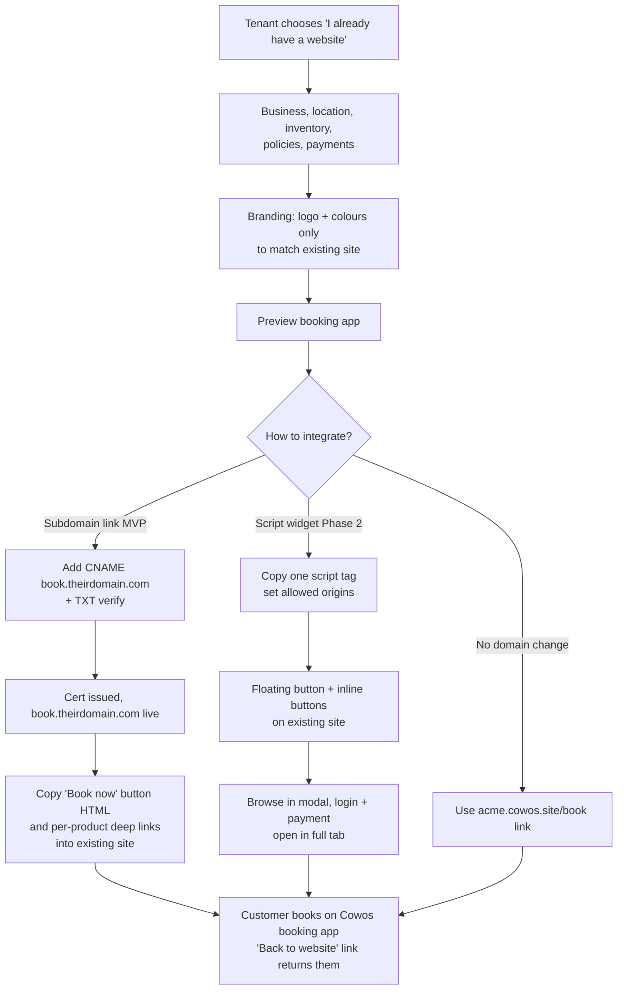
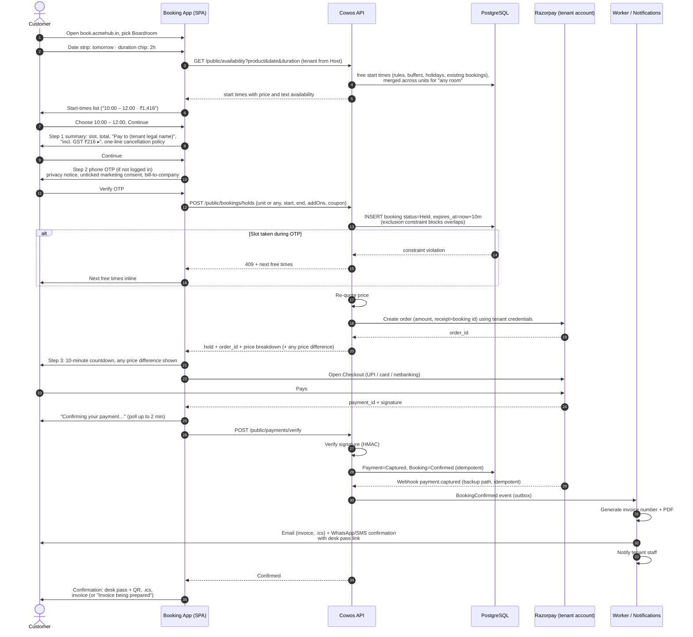
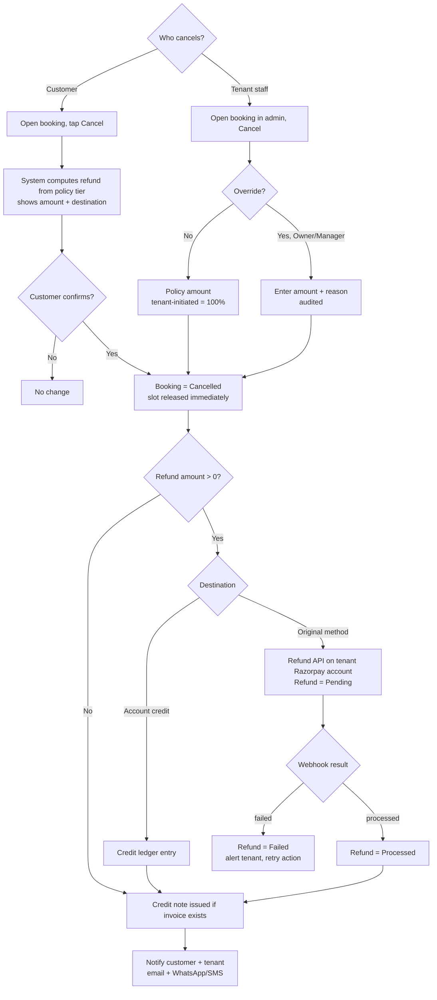
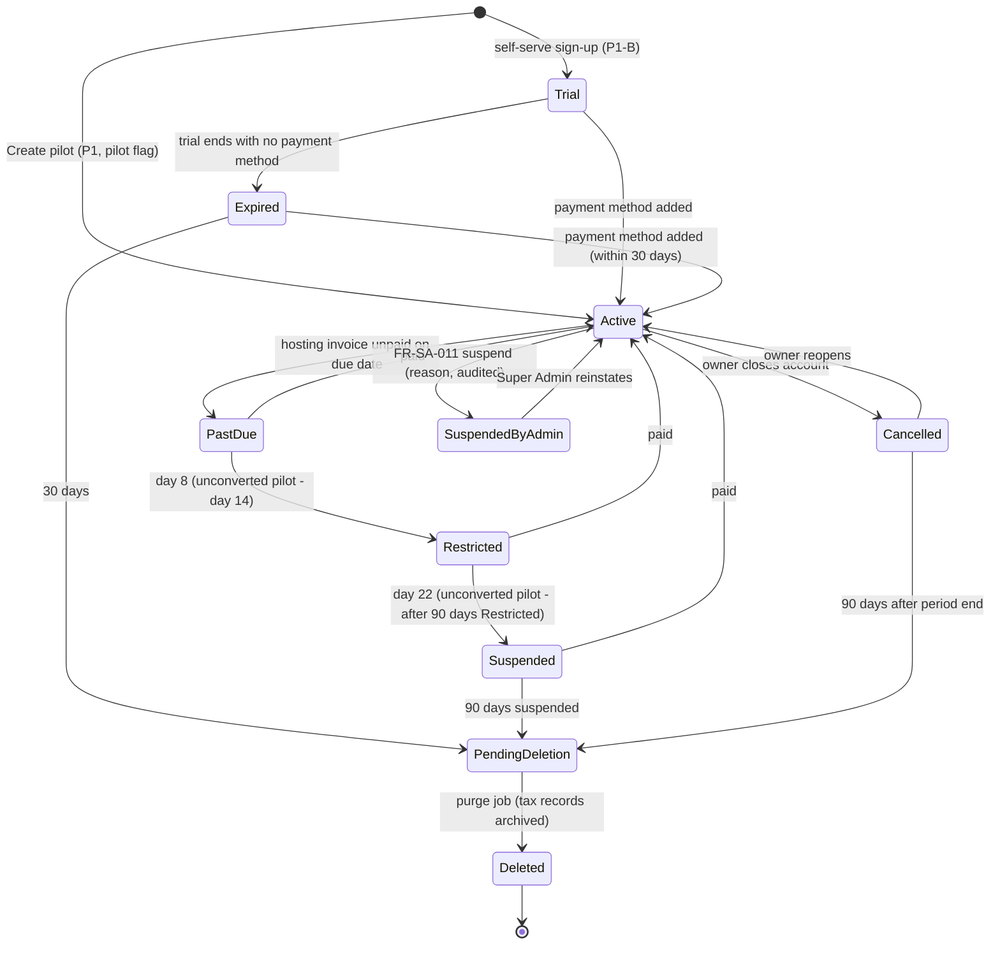
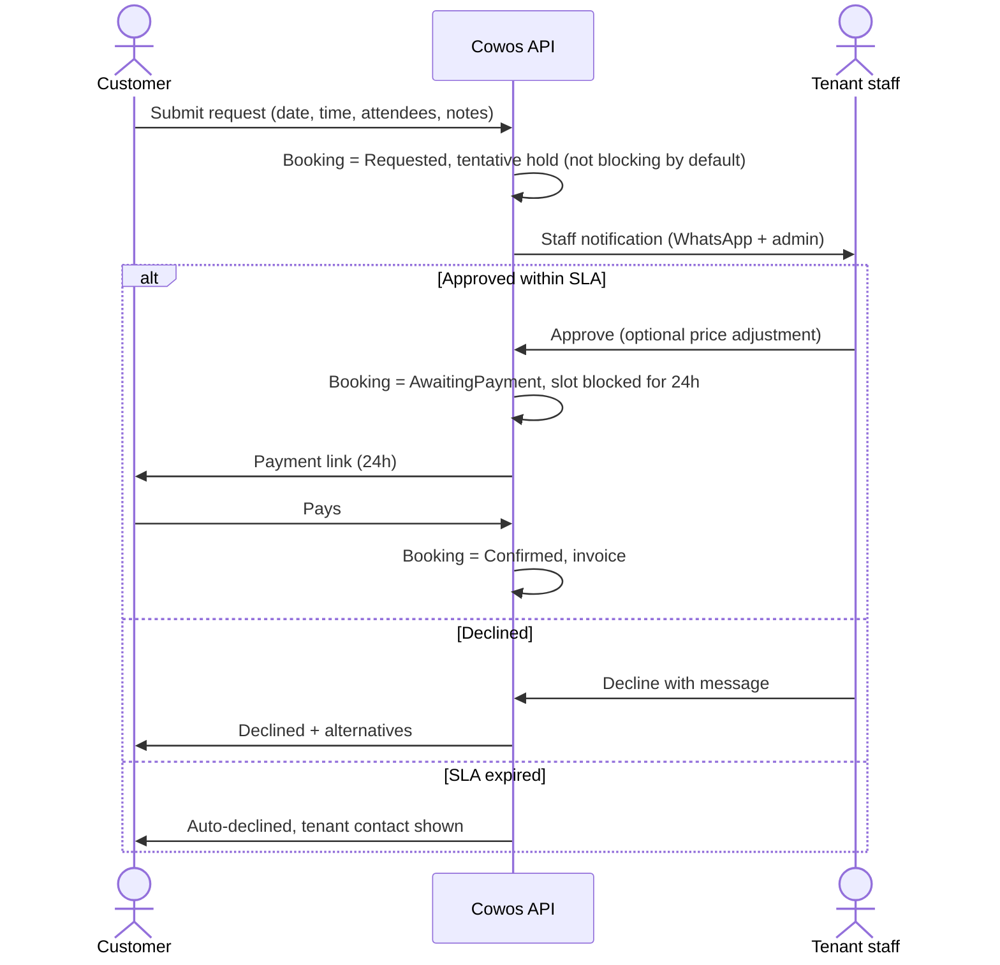
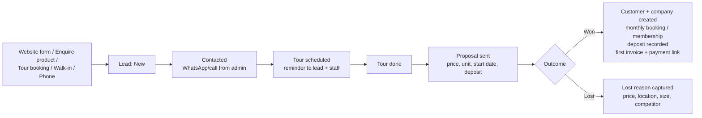

# 06 · Key User Flows

> Cowos requirements pack · v0.2 draft · Diagrams are Mermaid (render on GitHub and in most Markdown viewers).

## Flow 1 · Owner onboarding → build → preview → publish

There are two paths. At launch (P1), every tenant is a pilot created by SSPL in Super Admin (Flow 1a). Public self-serve sign-up and the onboarding wizard arrive with the Billing release (P1-B, Flow 1b) (CEO-S1, CEO-S2). Both paths end in the same pre-publish checks, review and publish steps (Flow 1c). No path has a plan picker or a subscription checkout (D1, 28A).

### Flow 1a · Pilot path (P1)

Key rules (pilot path):
- Pilots are created directly in Active with a pilot flag. Trial expiry, trial publish rules and dunning never apply. The free year starts at the first live publish on production and ends 12 months later (Pilot Rules #3, #4).
- The pre-handover setup grant gives SSPL write access only while the tenant has no Owner, is unpublished and has no live payments. It ends when the Owner accepts the invite. After handover SSPL works only through tenant-approved grants (FR-SA-030) (R19, Pilot Rules #9).
- The owner does Razorpay KYC and OAuth, GSTIN/PAN, DNS changes, and accepts the ToS and DPA themselves (Pilot Rules #9).
- Until the production entry gate passes, the publish screen shows "Your site is ready. Publishing opens when Cowos launches". The gate blocks only publishing and live payments (Pilot Rules #1, 11A).
- Double submit of Create pilot creates one tenant (idempotency key); a taken slug returns 409. A resend revokes the old invite link (CEO A2).

### Flow 1b · Self-serve path (P1-B)

Key rules (self-serve path):
- The wizard order follows 4A. Sample inventory is labelled "Sample"; pre-publish checks block publishing while any sample item remains (FR-TA-008).
- Trial tenants can publish to the platform subdomain, marked `noindex`. A tenant becomes Active when it adds a payment method (Razorpay payment link details, or UPI Autopay / e-mandate up to ₹5,000) at the end of the trial; custom domains and indexing then unlock without waiting for the first arrears invoice (Pilot Rules #7, 28A).
- If Razorpay KYC is pending, the owner can still publish with Book a tour, Request to Book and offline payment; Instant Book products show as "Request" until Razorpay is live (33A).

### Flow 1c · Pre-publish checks → review → publish (both paths)

Key rules (publish):
- Domain verification runs in the background. The tenant can publish on the platform subdomain while waiting.
- The live-pointer switch re-reads tenant state in the same transaction, so a publish that finishes after a suspension never puts the normal site back (CEO-A1). The edge learns of the switch only through the edge_sync outbox (R17).
- A pilot's first live publish on production sets its free-period end date (Pilot Rules #3).

## Flow 2 · Existing-website integration (booking app only)

The "I already have a website" goal choice is a wizard step and arrives with the wizard at P1-B (FR-TA-006, CEO-S2).

## Flow 3 · Customer booking → payment → confirmation (Instant Book)

The hold starts only after OTP, never before (2A). A UPI return or a reload opens `/book/checkout/{bookingRef}`, which needs the customer's session; without one the page asks for OTP and then shows the booking's state (R16).

Edge cases handled:
| Case | Behaviour |
|------|-----------|
| Customer closes the browser after paying | Webhook confirms the booking; customer gets notifications anyway |
| Webhook slower than the client | "Confirming your payment…" for up to 2 minutes, then "We've got your payment, confirmation is on its way by WhatsApp"; never an error (9A) |
| Hold expires during payment, slot still free | Late capture confirms the booking |
| Hold expired before payment, slot still free | One-tap retry with a new hold (9A) |
| Hold expires, slot taken by someone else, payment captured | Automatic full refund: "Full refund of ₹X started, 5–7 working days" plus the next free times (9A) |
| Price changed between summary and hold | Hold re-quotes the price; the difference shows before Razorpay opens (2A) |
| Payment fails | Hold released immediately; customer can retry with a new hold |
| Webhook arrives before client verify | Same idempotency key (gateway payment id); second call is a no-op |
| Gateway down | App offers Request to Book (9A) |
| Tenant in `Restricted` state (P1-B) | Hold creation refused; booking app shows "Call / WhatsApp to book" with the tenant's contacts (10A) |
| Tenant `Suspended` | Website shows the suspended page; no new holds (10A, CEO-A1) |

## Flow 4 · Cancellation and refund

Notes:
- Refunds come from the tenant's Razorpay balance. If the tenant's balance is insufficient, Razorpay may fail or queue the refund; the tenant gets a clear alert.
- Gateway fees are not returned by Razorpay. Whether the customer refund deducts them is a tenant policy setting and is shown in the policy text.
- Monthly bookings and memberships don't use this flow; they follow notice-period rules handled by staff (Phase 2 automates it).

## Flow 5 · Tenant states: hosting invoice lapse → restriction → suspension → deletion

Key rules:
- **At launch (P1)** the only transitions are Create pilot (into Active with the pilot flag), FR-SA-011 suspend and reinstate. Super Admin offers no move into Trial, PastDue or Restricted, and the API rejects one with 409 until the Billing release (P1-B) enables trials and dunning (Q1, CEO-S1).
- Pilots stay Active through the free year: no payment method, trial expiry or dunning applies. The free year runs 12 months from the first live publish on production (Pilot Rules #3, #4).
- From month 13 a former pilot pays its hosting cost share; month 13 is invoiced on the 10th of month 14. A pilot that hasn't paid that first invoice by its due date plus 14 days is unconverted: it moves to Restricted and stays there for 90 days before the normal Suspended lifecycle. A former pilot that pays and then misses a later invoice follows the standard schedule (Pilot Rules #6).
- Hosting invoices are issued on the 10th for the previous month and are due in 10 days (Pilot Rules #10, R1).
- Every state change raises one TenantStateChanged event; the website switch for Restricted and Suspended goes through the data-refresh render in FR-PL-012 (R11, CEO-A1).

What each state allows:

| State | Website | Booking app: new bookings | Booking app: existing customers | Tenant admin | Notifications |
|-------|---------|--------------------------|-------------------------------|--------------|---------------|
| Trial (P1-B) | Live on platform subdomain (`noindex`) | Yes | Yes | Full (custom domain locked) | Day 10–14 reminders |
| Active | Live | Yes | Yes | Full | Monthly hosting invoice on the 10th; pilots: free-year notices at 60, 30 and 7 days |
| PastDue (days 0–7, P1-B) | Live | Yes | Yes | Full + banner | Daily |
| Restricted (days 8–21, P1-B) | Live; every Book CTA becomes "Call / WhatsApp to book", with no billing mention (10A) | **No**: booking app home shows the tenant's call/WhatsApp options | View, cancel, invoices | Read-only + billing, exports, booking management | Every 2 days |
| Suspended (day 22+, P1-B) | Page in the tenant's theme with name, address, phone, WhatsApp, "Online booking is temporarily unavailable" and the badge (10A) | No | View bookings, download invoices | Billing, export, cancel only | Day 30, 60, 80 |
| Expired (trial ended with no payment method, P1-B) | Offline | No | View | Billing + export | Day 1, 7, 25 |
| Cancelled (P1-B) | Live until period end, then as Suspended | Until period end | Yes | Until period end, then billing/export | Export reminders |
| SuspendedByAdmin | Suspended page in the tenant's theme, as Suspended (10A, CEO-A1) | No | No | Owner can see the reason and contact SSPL; publish blocked | Immediate |
| PendingDeletion → Deleted | Offline, DNS mapping removed | No | No | No | Final notice 7 days before purge |

## Flow 6 · Request to Book (event space)

## Flow 7 · Lead → tour → membership (sales-led cabins and dedicated desks)

