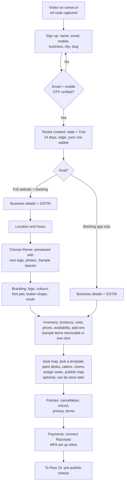
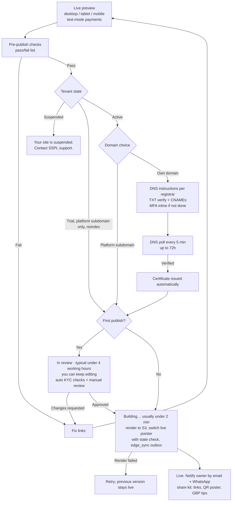
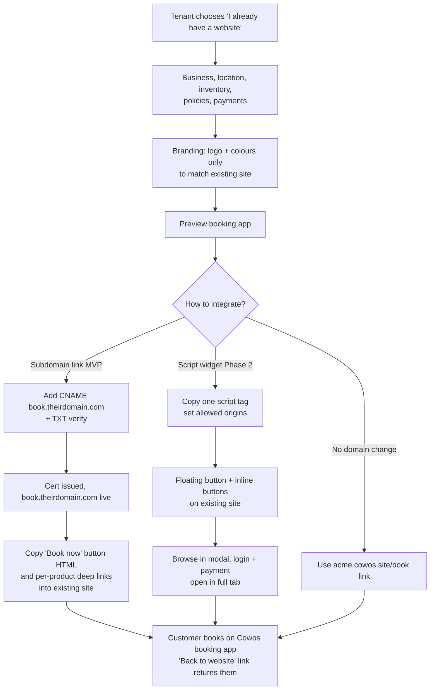
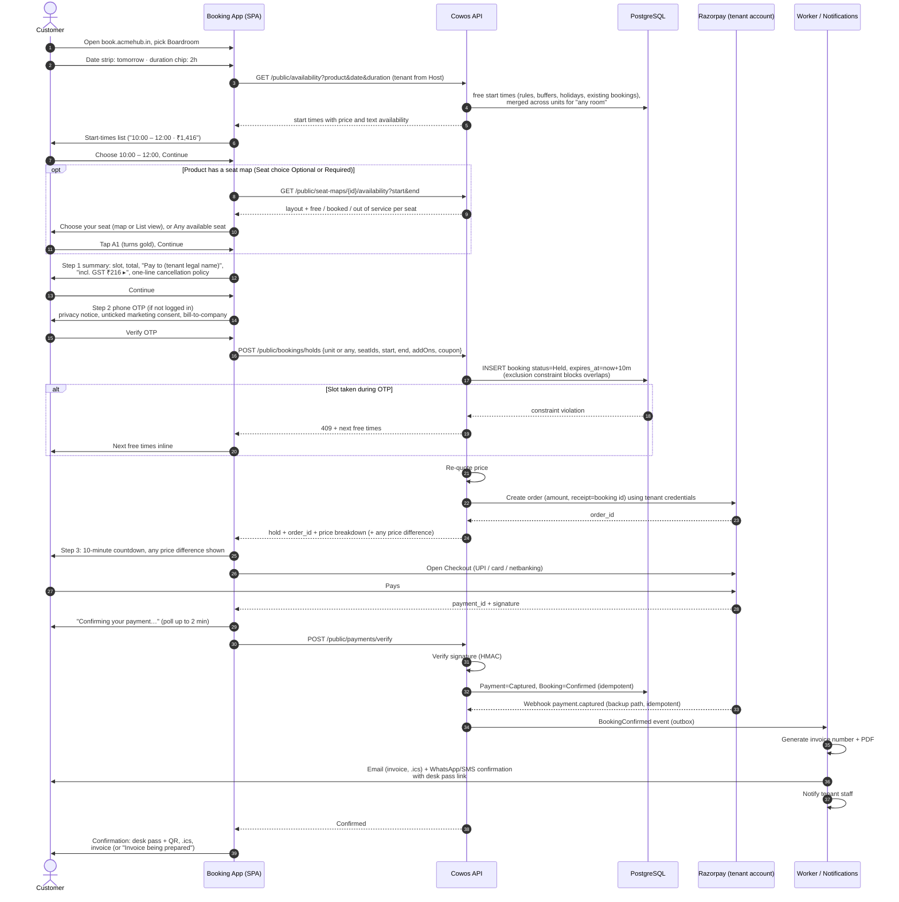
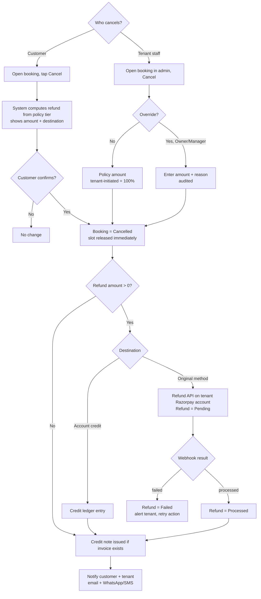
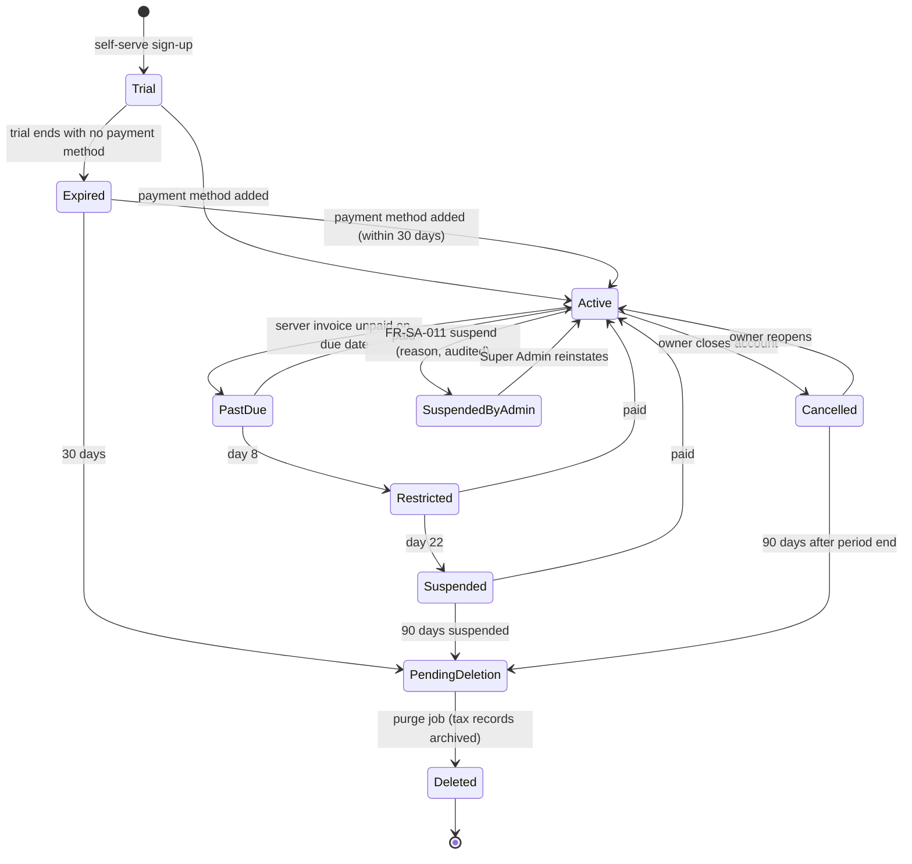
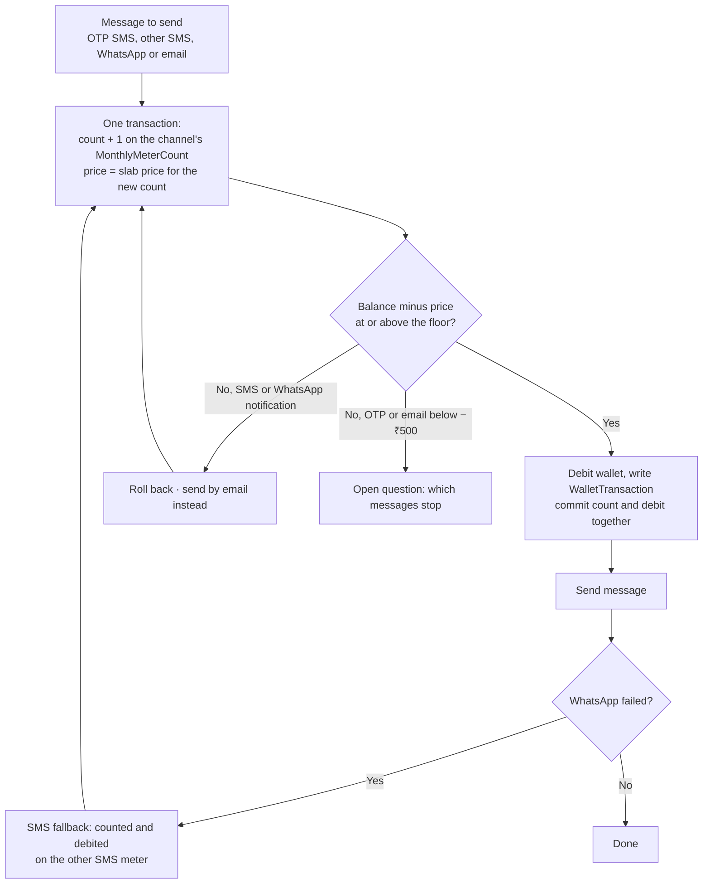
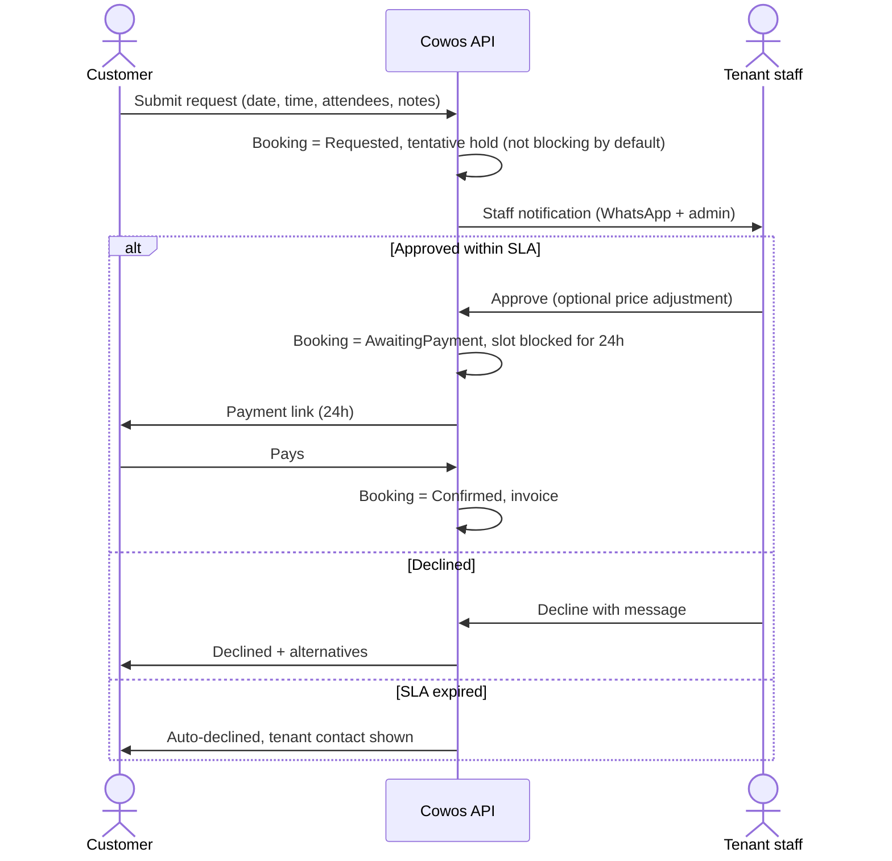
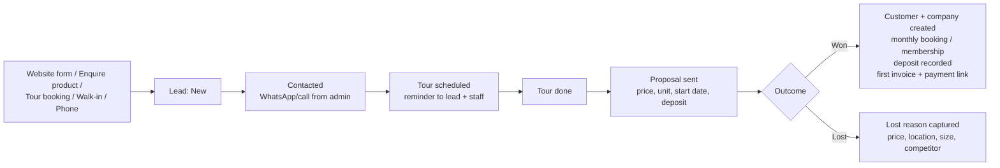

# 06 · Key User Flows

> Cowos requirements pack · v0.4 draft · Diagrams are Mermaid (render on GitHub and in most Markdown viewers).

## Flow 1 · Owner sign-up → wizard → preview → publish

There is one path: the owner signs up self-serve on cowos.in, completes the onboarding wizard (Flow 1a), then runs the pre-publish checks, review and publish (Flow 1b). It is available from launch (Pricing Rule #9). The "Book a demo" form on cowos.in stays as a lead channel: requests go to Super Admin → Tenants → Demo requests, and SSPL follows up (CEO-A2). There is no plan picker or subscription checkout (D1, 28A).

### Flow 1a · Sign-up and onboarding wizard



Key rules (sign-up and wizard):
- The wizard order follows 4A. Each step auto-saves; the home checklist shows what remains (FR-TA-002). Sample inventory is labelled "Sample"; pre-publish checks block publishing while any sample item remains (FR-TA-008).
- The owner does Razorpay KYC and OAuth, GSTIN/PAN, DNS changes, and accepts the ToS and DPA themselves. SSPL helps only through Owner-approved support grants (FR-SA-030, Pricing Rule #9).
- The seat map step (Pricing Rule #13, FR-TA-068) offers templates first and can be skipped; products without a map work as plain pools and unit lists. Painting desks and blocks creates the units, so owners who draw a map need not type units in the inventory step.
- Trial tenants can publish to the platform subdomain, marked `noindex`. In Trial nothing is billed and notifications need wallet balance from day one. A tenant becomes Active when it chooses a plan (Fixed or Usage, Pricing Rule #12) and adds a payment method (Razorpay payment link details, or UPI Autopay / e-mandate up to ₹5,000); custom domains and indexing then unlock without waiting for the first arrears invoice (Pricing Rule #7, 28A).
- If Razorpay KYC is pending, the owner can still publish with Book a tour, Request to Book and offline payment; Instant Book products show as "Request" until Razorpay is live (33A).

### Flow 1b · Pre-publish checks → review → publish



Key rules (publish):
- Domain verification runs in the background. The tenant can publish on the platform subdomain while waiting.
- The live-pointer switch re-reads tenant state in the same transaction, so a publish that finishes after a suspension never puts the normal site back (CEO-A1). The edge learns of the switch only through the edge_sync outbox (R17).

## Flow 2 · Existing-website integration (booking app only)

The "I already have a website" goal choice is wizard step 1 (FR-TA-006).



## Flow 3 · Customer booking → payment → confirmation (Instant Book)



The hold starts only after OTP, never before (2A). A UPI return or a reload opens `/book/checkout/{bookingRef}`, which needs the customer's session; without one the page asks for OTP and then shows the booking's state (R16).

Edge cases handled:
| Case | Behaviour |
|------|-----------|
| Customer closes the browser after paying | Webhook confirms the booking; customer gets notifications anyway |
| Webhook slower than the client | "Confirming your payment…" for up to 2 minutes, then "We've got your payment, confirmation is on its way by WhatsApp"; never an error (9A) |
| Hold expires during payment, slot still free | Late capture confirms the booking |
| Hold expired before payment, slot still free | One-tap retry with a new hold (9A) |
| Hold expires, slot taken by someone else, payment captured | Automatic full refund: "Full refund of ₹X started, 5–7 working days" plus the next free times (9A) |
| Price changed between summary and hold | Hold re-quotes the price; the difference shows before Razorpay opens (2A) |
| Payment fails | Hold released immediately; customer can retry with a new hold |
| Webhook arrives before client verify | Same idempotency key (gateway payment id); second call is a no-op |
| Gateway down | App offers Request to Book (9A) |
| Tenant in `Restricted` state | Hold creation refused; booking app shows "Call / WhatsApp to book" with the tenant's contacts (10A) |
| Tenant `Suspended` | Website shows the suspended page; no new holds (10A, CEO-A1) |

## Flow 4 · Cancellation and refund



Notes:
- Refunds come from the tenant's Razorpay balance. If the tenant's balance is insufficient, Razorpay may fail or queue the refund; the tenant gets a clear alert.
- Gateway fees are not returned by Razorpay. Whether the customer refund deducts them is a tenant policy setting and is shown in the policy text.
- Monthly bookings and memberships don't use this flow; they follow notice-period rules handled by staff (Phase 2 automates it).

## Flow 5 · Metered billing and tenant states

Flow 5a shows the tenant states. Flow 5b shows how server usage becomes a monthly invoice. Flow 5c shows how each notification is counted and debited from the wallet. All of it runs from launch (Pricing Rules #3 to #8).

### Flow 5a · Tenant states: trial → active → unpaid server invoice → restriction → suspension → deletion



Key rules:
- Sign-up creates the tenant in Trial for 14 days. In Trial, server usage is not billed and notifications need wallet balance from day one. Adding a payment method makes the tenant Active (Pricing Rule #7).
- Server invoices are issued on the 1st for the previous calendar month (IST) and are due in 10 days. Unpaid invoices follow the BRD §7.3 schedule from launch: PastDue on the due date, Restricted at day 8, Suspended at day 22, then retention and deletion (Pricing Rules #5, #8).
- Super Admin suspends and reinstates manually with a reason (FR-SA-011); the other moves come from sign-up, payment-method and dunning events.
- Every state change raises one TenantStateChanged event; the website switch for Restricted and Suspended goes through the data-refresh render in FR-PL-012 (R11, CEO-A1).

What each state allows:

| State | Website | Booking app: new bookings | Booking app: existing customers | Tenant admin | Notifications |
|-------|---------|--------------------------|-------------------------------|--------------|---------------|
| Trial | Live on platform subdomain (`noindex`) | Yes | Yes | Full (custom domain locked) | Day 10–14 reminders |
| Active | Live | Yes | Yes | Full | Monthly server invoice on the 1st |
| PastDue (days 0–7) | Live | Yes | Yes | Full + banner | Daily |
| Restricted (days 8–21) | Live; every Book CTA becomes "Call / WhatsApp to book", with no billing mention (10A) | **No**: booking app home shows the tenant's call/WhatsApp options | View, cancel, invoices | Read-only + billing, exports, booking management | Every 2 days |
| Suspended (day 22+) | Page in the tenant's theme with name, address, phone, WhatsApp, "Online booking is temporarily unavailable" and the badge (10A) | No | View bookings, download invoices | Billing, export, cancel only | Day 30, 60, 80 |
| Expired (trial ended with no payment method) | Offline | No | View | Billing + export | Day 1, 7, 25 |
| Cancelled | Live until period end, then as Suspended | Until period end | Yes | Until period end, then billing/export | Export reminders |
| SuspendedByAdmin | Suspended page in the tenant's theme, as Suspended (10A, CEO-A1) | No | No | Owner can see the reason and contact SSPL; publish blocked | Immediate |
| PendingDeletion → Deleted | Offline, DNS mapping removed | No | No | No | Final notice 7 days before purge |

### Flow 5b · Metering and monthly server invoice

```mermaid
flowchart TD
    A[CloudFront standard logs to S3<br/>website + booking-app hosts] --> B[Daily job: map host to tenant<br/>drop WAF-blocked and SSPL monitoring<br/>count 2xx/304 page views and /api/* calls<br/>per IST day]
    B --> D[(UsageDaily<br/>tenant, meter, date, units)]
    E[Daily storage snapshot<br/>GB of media and files per tenant] --> D
    D --> F[Daily estimate: rate month-to-date units<br/>with the rate card in force]
    F --> G[Billing page: units per meter,<br/>slab breakdown, This month so far]
    D --> H[1st of the month, IST: rating job<br/>sum last month's units per server meter<br/>leave out Trial days]
    RC[(Rate card version in force<br/>slab table per meter)] --> F
    RC --> H
    H --> I[Usage plan: apply slabs telescopically, one line per server meter<br/>Fixed plan: one Fixed plan line, prorated only in first and last month<br/>no plan period for a billable day: hold + alert (R3-E1)<br/>GST added]
    I --> J[Invoice to Owner by email + WhatsApp<br/>due in 10 days]
    J --> K{Payment method}
    K -- Payment link --> L[Owner pays by Razorpay link]
    K -- UPI Autopay / e-mandate --> M[RBI pre-debit notice<br/>then charge, max ₹5,000]
    L --> N{Paid by due date?}
    M --> N
    N -- Yes --> O[Invoice paid · tenant stays Active]
    N -- No --> P[PastDue → dunning per Flow 5a]
```

Key rules (server billing):
- 1 request unit = 1,000 requests; 1 storage unit = 1 GB-month, the average of the month's daily snapshots (Pricing Rule #3).
- Slabs apply telescopically: units in slab 1 at the slab-1 price, the next units at the slab-2 price, and so on. Counts reset at the start of each calendar month (IST). A slab price can be ₹0 (Pricing Rule #4).
- The invoice uses the rate card version in force for the month the usage happened, never a later one (Pricing Rule #4).
- Usage records are kept so the Owner can see the daily units behind every invoice line (FR-PL-068).
- CUR 2.0 is loaded only for SSPL's cost view (FR-SA-022); it is never used to bill tenants (Pricing Rule #10).

### Flow 5c · Notification wallet debit



Key rules (wallet):
- Floors: ₹0 for SMS and WhatsApp notifications; −₹500 for OTPs and emails. What stops at the −₹500 floor is an open question (Pricing Rule #6).
- A WhatsApp message followed by its SMS fallback counts once on each meter (Pricing Rule #3).
- The wallet page shows the month-to-date count and current slab per channel (FR-TA-180). Minimum top-up ₹500.

## Flow 6 · Request to Book (event space)



## Flow 7 · Lead → tour → membership (sales-led cabins and dedicated desks)


