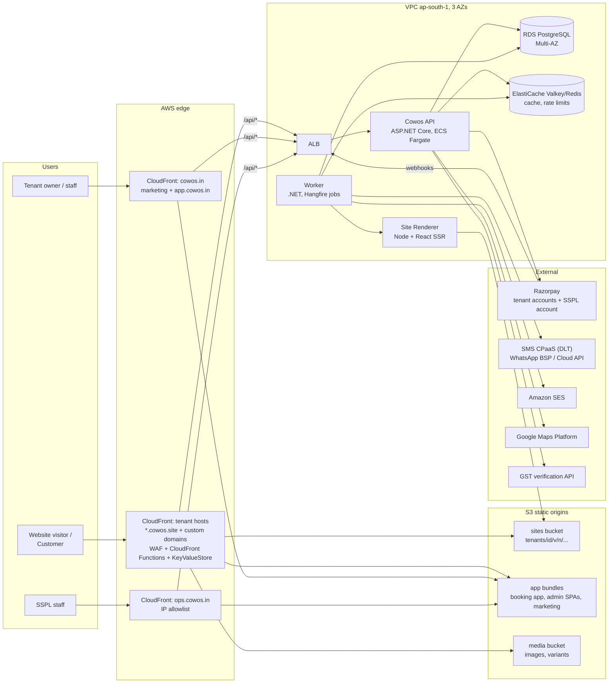
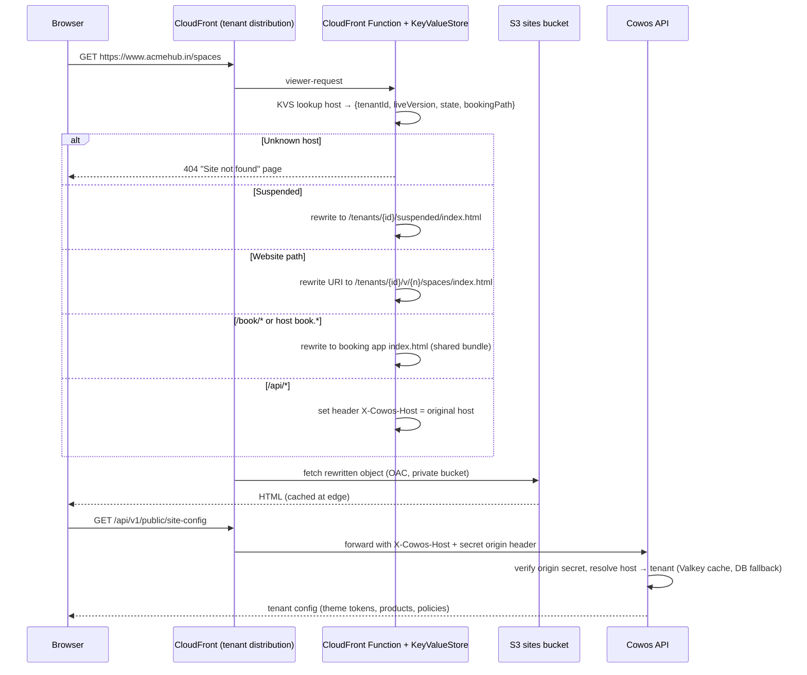
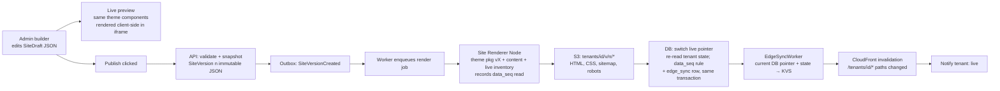
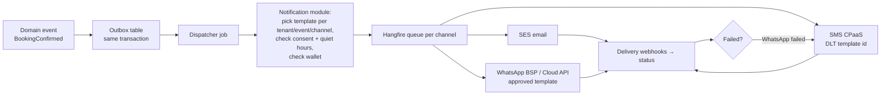
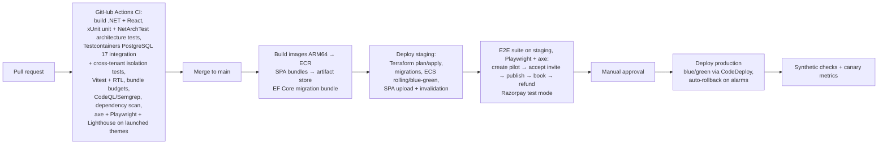

# 08 · High-Level Architecture

> Cowos requirements pack · v0.2 draft · Stack: ASP.NET Core (.NET 10 LTS), React + TypeScript, PostgreSQL, AWS (ap-south-1 Mumbai primary)

## 1. Architecture principles

1. **Shared platform, isolated data.** One deployment serves all tenants (pool model); isolation by `tenant_id` + Row-Level Security. Dedicated cells later (P3) for tenants who need them.
2. **Static where possible.** Tenant websites are rendered at publish time and served from the CDN. No compute per page view.
3. **Modular monolith first.** One .NET API and one worker, split into modules with enforced boundaries. Extract services only when a module has a scaling or team reason.
4. **Money paths are boring and idempotent.** Every payment-affecting operation has an idempotency key, a state machine, and a reconciliation job.
5. **Tenant context is never trusted from the client.** It comes from the host (verified at the edge) or a signed token.

## 2. System context



## 3. Deployable units

| Unit | Tech | Hosting | Notes |
|------|------|---------|-------|
| Marketing site (`cowos.in`) | React + TS, pre-rendered (Vite SSG or Next.js static export) | S3 + CloudFront | Rebuilt on content change; CMS optional (MDX files in repo for v1) |
| Tenant Admin SPA (`app.cowos.in`) | React + TS, Vite, TanStack Query, React Router, component library (e.g. shadcn/ui on Radix for accessibility) | S3 + CloudFront | Talks to API via BFF endpoints under `/api` (same origin) |
| Super Admin SPA (`ops.cowos.in`) | Same stack, separate build | S3 + CloudFront with IP allowlist / AWS Verified Access | Separate build so admin code never ships to tenants |
| Booking App | React + TS, Vite, one build for all tenants, with one booking-shell chunk per theme | S3 + CloudFront (tenant distribution) | Reads tenant config at boot; loads only the tenant's theme shell chunk; colour roles via CSS variables (§9, 16A, R13) |
| Tenant websites | Static HTML/CSS (+ small JS) per tenant version | S3 + CloudFront (tenant distribution) | Produced by the Site Renderer |
| Cowos API | ASP.NET Core 10 Web API, EF Core 10, Npgsql | ECS Fargate, ≥2 tasks across AZs, behind ALB | Modular monolith |
| Worker | .NET 10 Worker + Hangfire (PostgreSQL storage) | ECS Fargate, ≥1 task (2 in prod) | Background and scheduled jobs, including the single EdgeSyncWorker consumer (§6, R17) |
| Site Renderer | Node.js 22 LTS + React `renderToString`, shares theme packages with admin preview | ECS Fargate task (on-demand via job queue) or Lambda container | Only Node service; stateless |
| Database | PostgreSQL 17 on RDS, Multi-AZ, gp3 | RDS | `btree_gist`, `pg_trgm`, `citext` extensions |
| Cache | ElastiCache (Valkey) | Single small node in v1 | Rate limiting, host→tenant cache, OTP throttles |

## 4. Backend modules (modular monolith)

| Module | Owns | Key collaborators |
|--------|------|-------------------|
| `Identity` | Tenant users, customers (per tenant), OTP, MFA, tokens, roles | All |
| `Tenancy` | Tenants, tenant state machine (pilot transitions: created Active, free-period end, 90-day Restricted hold; launch guard rejecting moves into Trial/PastDue/Restricted with 409 until P1-B), one `TenantStateChanged` event per state change, `data_seq`, feature flags, tenant catalog (cell mapping). No plan limits (D1, F-C2, Q1, R18) | PlatformBilling, Sites |
| `Sites` | Themes, site drafts, versions, pages, media references, publish pipeline, live pointer `(version_id, data_seq)` and its switch rules, TenantStateCtaService, `edge_sync` outbox and EdgeSyncWorker (§6, §8) | Renderer, Domains, Tenancy |
| `Domains` | Hostnames, verification, certificate status; adds an `edge_sync` row on every routing change (no direct KVS writes, R17) | Sites, Tenancy |
| `Inventory` | Locations, products, units, pricing, add-ons, availability rules, holidays, tours | Booking |
| `Booking` | Availability engine, holds, bookings, requests, check-in, reschedule, cancellation | Inventory, Payments, Invoicing |
| `Payments` | Gateway connections, orders, payments, refunds, webhooks, reconciliation | Booking, Invoicing |
| `Invoicing` | Invoice series, invoices, credit notes, PDF generation, GST calculation | Payments, Booking |
| `Crm` | Customers, companies, leads, tours, notes, consent records, DPDP requests | Booking |
| `Memberships` (P2) | Plans, memberships, credit ledgers, renewals | Booking, Invoicing |
| `Promotions` | Coupons, redemptions | Booking |
| `Notifications` | Templates, dispatch, delivery tracking, atomic conditional wallet debits with floors (R4), pilot fair-use cap counters (Pilot Rules #5) | All (via events) |
| `PlatformBilling` | Messaging wallet (P1: SSPL-funded pilot wallets; P1-B: non-pilot top-up). P1-B: hosting-cost billing from AWS Data Exports (CUR 2.0): BillingProfile, CostPool, TenantCostShare, HostingInvoice, AdjustmentLine; the MonthlyHostingBilling job; ChargeEstimateService; pricing JSON; payment links and UPI Autopay / e-mandate; dunning (D1, R2, R12, R15, CEO-S1) | Tenancy, Notifications |
| `PlatformAdmin` | Super Admin actions. `PilotProgram`: one PilotProgramService (Create pilot tenant, Pilot requests, pilot Scorecard query) behind one Super Admin "Pilots" page with three tabs, plus the pre-handover setup grant. The Owner invite reuses the `Identity` staff invite (FR-TA-172) with the Owner role (CEO-A2, CEO-A4, R19, R20) | Tenancy, Identity, Booking (read model), Audit |
| `Audit` | Audit events, support grants (tenant-approved and pre-handover) | All |
| `Reporting` | Read models, exports | All (read-only) |

Rules: modules talk through public interfaces (in-process) or domain events via the transactional outbox. No module reads another module's tables directly. Enforced with architecture tests in CI (NetArchTest), including a rule that no separate owner-invite service exists.

Billing pipeline (P1-B, R1, R2): AWS Data Exports (CUR 2.0) from the production account land in S3 with a daily refresh. On the 10th the worker job MonthlyHostingBilling checks that the bill is final (`bill_invoice_id` populated). If not, or if export data is missing, it holds invoices, alerts Finance and retries daily. Otherwise it builds the CostPool for the month (net of AWS credits, with a service breakdown), counts tenants in Active, PastDue or Restricted on any day of the month, splits the pool by tenant-days into TenantCostShare (SSPL test and demo shares go to SSPL; pilot shares in the free period are recorded and absorbed, with no ₹0 invoice), and writes a HostingInvoice with GST added, due in 10 days. It re-reads the prior month and writes an AdjustmentLine on this invoice when AWS changed it. The equal split ships in v1; a weighted split is reviewed after 3 months of bills (R9). Launch carries none of these five tables; the Billing release adds them as additive migrations and backfills a BillingProfile for every existing tenant.

## 5. Multi-tenancy strategy

### 5.1 Options compared

| | Shared schema + `tenant_id` + RLS | Schema per tenant | Database per tenant |
|---|---|---|---|
| Isolation | Logical (two layers: app filter + RLS) | Stronger logical boundary | Strong |
| Migrations | One migration, one schema | Run N times; drift and partial-failure handling at 1,000+ schemas | Run N times across N databases |
| Connection pooling | One pool | `search_path` per request complicates pooling; catalog bloat at thousands of schemas | Pool per DB; RDS cost per DB if separate instances |
| Cross-tenant analytics (platform metrics) | Simple SQL | UNION across schemas | ETL required |
| Per-tenant restore | Harder (selective restore runbook) | Easier (dump one schema) | Easiest |
| Cost | Lowest | Low | Highest |
| Fit for 1,500 small tenants | Best | Workable but operationally heavy | Poor (except for a few large tenants) |

### 5.2 Recommendation

**Shared schema with `tenant_id` on every tenant-owned table, enforced by PostgreSQL Row-Level Security and EF Core global query filters.** Large tenants who need it later get a **dedicated cell** (their own database with the same schema), selected through the tenant catalog. That gives the hybrid model from 00 §C2 without a second code path.

Implementation sketch:

```sql
-- Every tenant table
ALTER TABLE booking ENABLE ROW LEVEL SECURITY;
ALTER TABLE booking FORCE ROW LEVEL SECURITY;
CREATE POLICY tenant_isolation ON booking
  USING (tenant_id = current_setting('app.tenant_id', true)::uuid)
  WITH CHECK (tenant_id = current_setting('app.tenant_id', true)::uuid);
-- missing setting → NULL → zero rows (fail closed, no error)
```

```csharp
// Every DB unit of work (API request, job step) runs in an explicit transaction
// opened by middleware / an interceptor. Its first statement is:
// SELECT set_config('app.tenant_id', @tenantId, true);  -- 'true' = local to the transaction
// The setting ends with commit or rollback. Session-level SET is banned.
// EF Core global query filter: modelBuilder.Entity<Booking>().HasQueryFilter(b => b.TenantId == _tenant.Id);
```

- Tenant context (R3): every API request and job step runs in one explicit transaction that sets the tenant first. Jobs commit per tenant. No code path sets the tenant at session level, because a session setting through RDS Proxy pins the connection and can leak to the next borrower. CI runs a pooled-connection leak test through RDS Proxy that alternates tenants on reused connections, and an architecture test that bans session-level `SET` (NFR-MT-09).
- App DB role: `cowos_app` with `NOBYPASSRLS`. Platform-wide admin queries (Super Admin lists) go through a separate, narrow `cowos_platform` role used only by the platform module, on views that expose non-personal fields. Platform tables that hold no tenant data (for example pilot requests) sit in the platform schema outside tenant RLS, readable only by the Super Admin role (CEO-A2).
- Sweeper role (R8): cross-tenant sweeps (hold expiry, reminders, no-show) use a `cowos_sweeper` role whose read-only RLS policies expose only `(id, tenant_id)` of rows matching each sweep predicate. The sweep partial indexes serve these queries (09 §4, R7). The worker then handles each returned row in its own per-tenant transaction as above. The role cannot read other columns or write; an isolation test proves it.
- Primary keys: UUIDv7 (time-ordered, avoids hot index pages, safe to expose). Every tenant table indexes `(tenant_id, …)` first.
- Composite foreign keys including `tenant_id` where practical, so a row can't reference another tenant's row even by bug.

## 6. Tenant resolution by hostname



- The edge routing table (host → tenant, version, state) lives in **CloudFront KeyValueStore**. The database is the source of truth; KVS is a copy that is updated only by the **EdgeSyncWorker** (R17):
  1. Every change to a tenant's live pointer, state or hostnames (publish, rollback, data refresh, suspend, reinstate, domain change, pilot creation) adds a tenant row to the `edge_sync` outbox in the same transaction as the DB change.
  2. One EdgeSyncWorker drains the outbox continuously. For each tenant it reads the **current** DB pointer and state at send time (not the value the job wrote) and writes them to KVS with `UpdateKeys`, passing the store's current ETag in `IfMatch`. On 409 it re-reads the ETag and retries. It batches many tenants into one `UpdateKeys` call.
  3. No other job writes KVS directly. Because the worker always copies current DB values, KVS ends equal to the DB whatever order jobs commit or retry in.
  4. If the worker is down, the outbox grows and the edge keeps its last value; an alert fires when the oldest unsent row is older than 2 minutes. On restart the worker resends current values.
  Updates propagate in seconds. Tests: KVS writes forced into the reverse of the DB commit order end with KVS equal to DB; a worker restart mid-batch resends current values.
- **Rollback path:** rollback (FR-TA-044) switches the DB live pointer to an existing S3 prefix and adds an `edge_sync` row in the same transaction; the EdgeSyncWorker writes it to KVS. No rebuild; live within 60 seconds.
- **Suspended:** the KVS state routes the host to the suspended page, rendered in the tenant's theme by TenantStateCtaService (10A, CEO-A1, §8).
- The API trusts `X-Cowos-Host` only when the request carries the CloudFront-only origin secret header (rotated) or comes through a CloudFront VPC origin. Direct ALB access is blocked by security group (CloudFront managed prefix list).
- Same-origin `/api` on every tenant host: no CORS, host-only cookies per tenant, simpler CSP.

## 7. Custom domains and SSL automation

### 7.1 Options

| Option | How | Pros | Cons |
|--------|-----|------|------|
| **A. CloudFront SaaS Manager (multi-tenant distribution)** | One multi-tenant distribution template; each tenant domain is a "distribution tenant" with a CloudFront-managed ACM certificate validated once the tenant's CNAME points at the distribution | AWS-native, managed certificate issuance and renewal, scales to many domains, shares one config | Newer service (launched 2025): support for CloudFront Functions and KeyValueStore on distribution tenants is unconfirmed; the sprint-0 spike decides it (exit criteria below) |
| B. One CloudFront distribution + ACM cert per tenant | Terraform/API creates a distribution per custom domain | Well-understood | Distribution and certificate quotas need raising; slow propagation; config drift across hundreds of distributions |
| C. Self-managed TLS edge | Caddy (on-demand TLS with Let's Encrypt) or Envoy + cert-manager behind an NLB with static IPs | Full control; static IPs make apex A records possible | You operate a TLS edge (patching, scaling, rate limits from Let's Encrypt, DDoS), lose CloudFront caching unless chained |

**Recommendation:** Option A, subject to a 3-day time-boxed sprint-0 spike (R5). The spike passes only if it proves all four:
1. A viewer-request CloudFront Function reading KeyValueStore works on distribution tenants.
2. Managed certificates issue within 30 minutes of the CNAME pointing at the distribution.
3. Quotas fit 1,500 hosts (tenants per distribution, KVS size).
4. Cost per tenant is recorded.

If any criterion fails, fall back to Option C (Caddy on-demand TLS edge). Decision D15 stays Proposed until the spike passes. Platform subdomains (`*.cowos.site`) use one wildcard ACM certificate on the same tenant-facing setup.

### 7.2 Domain lifecycle

1. Tenant adds `acmehub.in`, chooses booking placement (`book.` subdomain or `/book`).
2. System creates a `Domain` row (status `PendingDns`) with a random TXT token; detects DNS provider by NS lookup; shows provider-specific instructions:
   - `CNAME www → <tenant-edge-target>` (e.g. `edge.cowos.site` or the distribution endpoint)
   - `CNAME book → <tenant-edge-target>` (if chosen)
   - `TXT _cowos-verify.acmehub.in → cowos-verify=<token>`
   - Apex: forwarding `acmehub.in → https://www.acmehub.in` at the registrar (guides for GoDaddy, Hostinger, BigRock, Namecheap, Cloudflare, Route 53; Cloudflare/Route 53 users can use CNAME flattening/ALIAS directly)
3. Worker polls DNS every 5 minutes (public resolvers, not cached) for up to 72 hours; on success → `Verified`.
4. Create distribution tenant / attach domain; request managed certificate → `CertPending` → `Active`.
5. Edge routing change recorded as an `edge_sync` row and written to KVS by the EdgeSyncWorker (§6); platform subdomain switches to 301 → custom domain.
6. Daily health check: DNS still points to Cowos, cert valid > 14 days. On failure → `Degraded`, tenant alerted, platform subdomain keeps serving.
7. Removal: tenant removes or account deleted → routing removed, certificate released.

Guard rails: block domains already attached to another tenant (unless TXT proves ownership again), block well-known brands/phishing patterns, any limit on custom domains is the same for every tenant (no plans, D1); whether a limit remains, and its number, is open.

## 8. Website rendering and publish pipeline



- **Themes** are versioned React packages in the monorepo (`packages/themes/loft`, `packages/themes/metro`, ...). Each exports section components, a JSON Schema for its content and a booking shell (§9, 16A). The same package powers the admin preview (client-side) and the renderer (server-side), so preview equals production. There are four named theme directions (Loft, Metro, Courtyard, Campus; 24A). Launch ships 2 (Loft and Metro, or the 2 that pilot validation favours); the other 2 follow about 6 weeks after launch, after validation with 3 pilot owners, each passing Lighthouse, axe and the screen reader pass before release (CEO-S3).
- **Content model** is theme-independent (sections keyed by type), so switching themes keeps content.
- **Live pointer:** the tenant's live pointer in the DB stores `(version_id, data_seq)`. It is the one value every render shares, and it changes only in the pointer switch step. The invariant: after every render job finishes, the pointer shows the newest owner-chosen version (publish or rollback) in the page variant that matches the tenant's current state.
- **State check at the switch (CEO-A1):** the switch re-reads tenant state in the same transaction. A normal-site render aborts if the tenant is Suspended; a suspended-page render aborts if it is not. An aborted render ends and logs tenant, state and version at info level. Owner publish is blocked while Suspended: the API returns 409 with "Your site is suspended. Contact SSPL support." and the reason.
- **Publish and rollback** switch the pointer as before (subject to the state check). **Rollback** points at an existing S3 prefix: no rebuild, live within 60 seconds through the EdgeSyncWorker (§6, FR-TA-044).
- **Live data on a static site:** inventory names and "from" prices are baked at build. A change to prices/inventory/hours triggers a debounced (60 s) **data refresh build** of the current version. The booking app always uses live data, and checkout re-quotes the price before payment (2A).
- **Data refresh rule (CEO-A3, R18):** `tenant.data_seq` increments in the same transaction as every website-visible data change (inventory names, prices, hours) and every tenant state change (suspend, reinstate, and from P1-B Restricted), because the state changes what the site shows; without that bump a reinstate render would carry no higher `data_seq` and be discarded. Every render records the `data_seq` it read. A data refresh (FR-PL-011 rebuilds and the RT4 reinstate render) switches the pointer only if `version_id` is unchanged and its `data_seq` is higher than the pointer's; otherwise it discards itself and logs. So a refresh that finishes after a newer publish, or after a newer refresh, never goes live. Tests: two refreshes released in both orders leave the newest data live; a refresh after a publish is discarded; a refresh with no newer publish goes live.
- **TenantStateCtaService (RT4, R11):** consumes one `TenantStateChanged` event. When a tenant enters or leaves Suspended or Restricted it enqueues a data-refresh render of the live version at lower priority than owner publishes, so pages show the right variant within about 2 minutes p95: Suspended shows the suspended page in the tenant's theme (name, address, phone, WhatsApp, "Online booking is temporarily unavailable", badge); Restricted switches every Book CTA to "Call / WhatsApp to book" (10A). At launch the only trigger is FR-SA-011 suspend and reinstate (CEO-A1); dunning adds Restricted and Suspended triggers at the Billing release (P1-B) as a second producer of the same event. A render that fails 3 times alerts Super Admin, and tenant detail shows "suspended page not live". If RT4 misbehaves, Super Admin falls back to FR-SA-011 unpublish while it is fixed.
- Retain the last 20 versions in S3; older prefixes deleted by a lifecycle job.

## 9. Booking app architecture

- One React SPA main bundle for all tenants (`/book/*` or `book.<domain>`). On boot it calls `/api/v1/public/site-config` (cacheable 60 s at the edge per host) for theme key and published version, colour roles, logo, products, policies.
- **Theme booking shell (16A, R13):** each theme package exports a booking shell: header and footer matching the website, the theme's type scale and fonts, and a product hero-image treatment. Booking screens (start-time picker, checkout, account) stay one shared component set. Each shell is built as its own chunk. ThemeShellLoader dynamic-imports only the tenant's shell chunk named in site-config (theme key + published version). The edge inlines the shell header/footer HTML with site-config, so there is no unbranded flash; if the chunk fails to load, the inlined header/footer stays and booking still works.
- **Bundle budgets (R13):** CI fails the build if the main bundle exceeds 200 KB gzip or any shell chunk exceeds 40 KB gzip (fonts excluded). A test asserts that a tenant on theme X never downloads theme Y (NFR-PERF-04, NFR-PERF-12). Theme visual-regression tests cover each booking shell.
- Branding tokens map to CSS custom properties (`--color-primary`, `--radius-button`, `--font-heading`). Colour roles are derived in OKLCH from the owner's colour (primary, hover, pressed, tint, border, link, focus ring, text-on-primary; light and dark) (23A). Fonts are self-hosted WOFF2 per theme, Latin subset by default, with matching Noto or Anek families for Telugu and Devanagari loaded only when the page contains that script (25A).
- Data fetching with TanStack Query; availability polling every 30 s on the start-time screen; optimistic UI never used for money operations.
- **Desk pass (17A, R10, R14):** confirmation messages link to `/book/pass/<opaque token>`. PassLinkService resolves the token (purpose `pass`, not expired, not revoked) and shows first name + last initial, date/time, room and tenant logo; the QR is a separate short-lived check-in code that the front desk scan (`/admin/check-ins/scan`) validates against the tenant. Phase 1 registers a service worker scoped to the pass route only, caching the opened pass page and QR image, cleared when the booking ends.
- **Resumable checkout (9A, R16):** `/book/checkout/<bookingRef>` and its status endpoint require the customer's session (ResumeLinkService); without one the page asks for OTP and then shows the state; another customer's session gets 404.
- Phase 2 PWA: service worker for shell caching, Add to Home Screen, web app manifest generated per tenant (name, icons, theme colour), Web Push via VAPID.

## 10. File and image storage

| Bucket | Content | Access |
|--------|---------|--------|
| `cowos-media-<env>` | Tenant uploads (originals private) and generated variants | Variants public via CloudFront with Origin Access Control; originals private |
| `cowos-sites-<env>` | Rendered tenant websites per version | Private, CloudFront OAC only |
| `cowos-apps-<env>` | SPA bundles (hashed, immutable, `Cache-Control: max-age=31536000, immutable`) | CloudFront OAC |
| `cowos-docs-<env>` | Invoices, credit notes, KYC docs, exports | Private; presigned URLs (5 min) issued after authorization; KYC with separate KMS key |

Media pipeline (worker): upload via presigned POST (size/type limited) → scan → decode/re-encode with libvips (NetVips binding; avoids ImageSharp's commercial licence threshold, confirm licensing) → strip EXIF GPS → variants 320/640/1024/1600/2400 in AVIF + WebP + JPEG → record dimensions and blurhash placeholder → available to builder.

## 11. Notifications



- Email from `"Acme Hub" <bookings@notify.cowos.site>` with `Reply-To: tenant email`; SPF/DKIM/DMARC on the sending domain. Phase 2: tenant's own sending domain with DKIM CNAMEs.
- SMS uses SSPL's DLT entity and templates with `{#var#}` for tenant name. Header (sender ID) e.g. `COWOSB`.
- WhatsApp: MVP from a Cowos number with tenant-named templates; Phase 2 tenant-owned numbers via embedded signup.
- Each send records provider message ID, cost, status.
- **Wallet debit (R4, Pilot Rules #10):** before each SMS or WhatsApp send, one conditional `UPDATE` debits the wallet only if `balance - cost` stays at or above the floor (0 for notifications, −₹500 for sign-in OTPs) and writes the WalletTransaction in the same transaction. If no row is updated, a notification goes by email only and an OTP falls back to email OTP. Messaging is charged at provider cost with no free allowance. Pilots use an SSPL-funded wallet with fair-use caps: 1,000 SMS + WhatsApp notifications per month, then email only and an SSPL alert; OTPs alert SSPL at 1,000 and pause phone OTP at 2,000 for the rest of the month. Every message sent counts, including a fallback SMS (Pilot Rules #5). A parallel-send test at a near-floor balance asserts no overspend.

## 12. Background jobs

Hangfire on PostgreSQL in v1 (one technology, built-in retries and dashboard, easy for a .NET team). Move high-volume queues to SQS if Hangfire throughput becomes a bottleneck.

| Job | Schedule / trigger | Notes |
|-----|-------------------|-------|
| Outbox dispatcher | Continuous (every 1 s) | Publishes domain events to handlers |
| EdgeSyncWorker | Continuous | Single consumer of the `edge_sync` outbox; writes current DB pointer and state to KVS (§6, R17) |
| Hold expiry | Every 30 s | Releases `Held` bookings past `hold_expires_at`; sweep via `cowos_sweeper` and partial index (R7, R8) |
| Request SLA expiry | Every 5 min | Auto-declines expired requests, expires payment links |
| Payment reconciliation | Hourly (last 48h) + nightly (last 7d) | Pulls gateway payments per tenant; fixes missed webhooks |
| Reminders | Every 5 min | Booking reminders per rules; sweep via `cowos_sweeper` and partial index (R7, R8) |
| No-show marking | Every 15 min | After grace period; sweep via `cowos_sweeper` and partial index (R7, R8) |
| DNS verification / health | Every 5 min (pending), daily (active) | |
| Site render / data refresh build | Event-driven | Debounced; switch rules in §8 |
| TenantStateCtaService render | Event-driven (`TenantStateChanged`) | Low priority, below owner publishes (§8, R11, CEO-A1) |
| MonthlyHostingBilling (P1-B) | 10th of each month, daily retry while held | CUR 2.0 → CostPool → TenantCostShare → HostingInvoice (+GST) → payment link; AdjustmentLine for prior-month changes (§4, R1, R2) |
| Charge estimate (P1-B) | Daily, after the CUR refresh | ChargeEstimateService: month-to-date pool plus a straight-line projection, divided by today's counted tenants; stored as low/high on CostPool, high = projection + 15% (R15) |
| Pricing JSON (P1-B) | After each billing run | Per-space average share for last month and the two before; no total bill, tenant count or tenant data; marketing pricing page rebuilt; last number kept if a run fails (R12) |
| Hosting dunning (P1-B) | Daily 06:00 IST | Reminders and automatic Restricted / Suspended moves per BRD §7.3, raising `TenantStateChanged` (CEO-S1) |
| Pilot free-year lifecycle (P1-B) | Daily | 60/30/7-day notices before the free-period end; unconverted pilots held in Restricted for 90 days (Pilot Rules #6, F-C2) |
| Membership renewals (P2) | Daily | Invoices N days ahead, credit grants at cycle start |
| Data export | On request | Zips to S3, emails link |
| Retention and purge | Daily | DPDP retention, tenant deletion |
| Media processing | Event-driven | |

Every job is idempotent and tenant-scoped: each job step runs in an explicit transaction that sets the tenant first, and jobs that iterate tenants commit per tenant (§5.2, R3). Cross-tenant sweeps find work only through the `cowos_sweeper` role.

## 13. Authentication and authorization

| Actor | Mechanism |
|-------|-----------|
| Tenant users | ASP.NET Core Identity + OpenIddict (OIDC server in the API), BFF pattern for the admin SPA (cookie session on `app.cowos.in`, tokens held server-side), TOTP MFA. Pilot Owners join through the Owner invite (staff invite flow FR-TA-172 with the Owner role: single use, 72-hour expiry, email verified by the link, phone OTP, password and MFA set by the owner) (CEO-A2) |
| Customers | Per-tenant accounts; phone/email OTP → short-lived JWT + rotating refresh cookie, host-only on the tenant host |
| SSPL staff | OIDC federation to Google Workspace / Entra ID; MFA enforced by IdP; `ops.cowos.in` restricted by IP / Verified Access |
| Service to service | IAM roles; no shared static credentials |
| Authorization | Policy-based (`[Authorize(Policy="Bookings.Refund")]`) with resource checks (tenant, location scope, refund limit). SSPL writes in a tenant need a support grant: the pre-handover setup grant before a pilot has an Owner (R19), tenant-approved grants after (02 §3.3) |

## 14. AWS infrastructure (production, v1)

| Component | Choice |
|-----------|--------|
| Region | ap-south-1 (Mumbai); DR backups to ap-south-2 (Hyderabad) |
| Accounts | AWS Organizations: `prod`, `staging`, `dev`, `backup`, `security/logs` |
| Network | VPC, 3 AZs, private subnets for ECS/RDS/Valkey; VPC endpoints for S3, ECR, Secrets Manager, CloudWatch to limit NAT costs |
| Compute | ECS Fargate (Graviton/ARM64 for cost): `api` (2–6 tasks), `worker` (2), `renderer` (0–N on demand) |
| Data | RDS PostgreSQL 17 Multi-AZ (db.t4g.medium → m7g.large as load grows), RDS Proxy |
| Edge | CloudFront (tenant multi-tenant distribution + platform distributions), AWS WAF, Route 53 |
| Messaging | SES (ap-south-1), external SMS/WhatsApp providers |
| Secrets | Secrets Manager + KMS (separate keys: general, payment credentials, KYC documents) |
| Observability | CloudWatch Logs/metrics, X-Ray or managed Grafana/Prometheus via OpenTelemetry, Sentry for frontends |
| IaC | Terraform (modules per environment); state in S3 with locking |
| Cost data (P1-B) | AWS Data Exports (CUR 2.0) from the `prod` account to S3, daily refresh; source of the hosting charge (§4, R2) |

Indicative monthly base cost for production v1 (on-demand, Mumbai, Oct 2026; validate with the AWS Pricing Calculator):

| Item | USD / month |
|------|------------:|
| RDS PostgreSQL db.t4g.medium Multi-AZ + 100 GB gp3 + backups | ~150 |
| ECS Fargate ARM (api 2×0.5 vCPU/1 GB, worker 2×0.5/1, renderer on demand) | ~70 |
| ALB | ~25 |
| NAT gateway (1, plus VPC endpoints) | ~45 |
| CloudFront + S3 (first 200 tenants) | ~30–60 |
| ElastiCache Valkey (small) | ~15 |
| WAF + managed rules | ~20 |
| CloudWatch logs/metrics | ~30 |
| Cross-region backup copies, KMS, Secrets Manager, Route 53 | ~25 |
| **Total** | **~410–440 (≈ ₹35,000–37,000)** |

Tenants pay their share of the actual production bill; SSPL charges no subscription, plan fee or commission. Each month's production AWS bill (net of credits, GST added) is split equally by tenant-days across counted tenants; messaging is charged separately at provider cost (D1, Pilot Rules #10). At 200 tenants this base cost is ≈ ₹180 per tenant per month before messaging; at 500 tenants ≈ ₹90 (with a modest DB upgrade) [estimated]. SSPL pays for staging, dev, CI, the marketing site and Super Admin, and absorbs pilot and unpaid shares. Staging adds ~30–40% of production if kept running; schedule it to scale down outside office hours.

## 15. CI/CD



- Monorepo layout:

```
/src
  /Cowos.Api                 # ASP.NET Core host
  /Cowos.Worker              # Hangfire worker host
  /Modules/<Module>          # Domain, Application, Infrastructure per module
  /Cowos.SharedKernel
/web
  /apps/marketing  /apps/admin  /apps/ops  /apps/booking
  /packages/ui  /packages/themes/*  /packages/site-schema  /packages/api-client
/renderer                    # Node site renderer
/infra                       # Terraform
/tests                       # integration, isolation, e2e (Playwright)
/docs/requirements           # this pack
```

- Test stack (R6): xUnit + FluentAssertions; integration tests on Testcontainers PostgreSQL 17 through WebApplicationFactory (real RLS, `btree_gist` exclusion constraints, transactions); Vitest + React Testing Library for the React apps; Playwright + axe end to end on staging with Razorpay test mode; NetArchTest for module boundaries. Docker is required in CI and locally. At launch the E2E suite also asserts that `/signup` and the sign-up API return 404 (public sign-up opens at P1-B, CEO-S1).
- API client for React generated from OpenAPI (e.g. `openapi-typescript` / Orval) so frontend and backend contracts stay in sync.
- Database migrations: EF Core migration bundles run as a one-off ECS task before the new version takes traffic; expand/contract pattern for breaking changes.
- Theme releases: visual regression (Playwright screenshots on 3 viewports × all launched themes and their booking shells × sample tenants), accessibility checks, Lighthouse CI budgets. Core Web Vitals and Lighthouse budgets must pass on every launched theme (launch checklist, CEO-S3). Themes 3-4 deploy as theme packages with no migration; their catalog entry stays hidden until Lighthouse, axe and the screen reader pass succeed. Existing tenants are moved to a new theme version only on their next publish, or via a controlled "rebuild all" job.
- Feature flags (per tenant) for gradual rollout. At launch, public sign-up and platform billing are not deployed (CEO-S1).
- Billing release order (P1-B, Pilot Rules #7): deploy billing dark → bill SSPL's paid test tenant → open public sign-up and the onboarding wizard → run one dunning cycle end to end before the first pilot converts. The first billing run covers the first full calendar month after the release.
