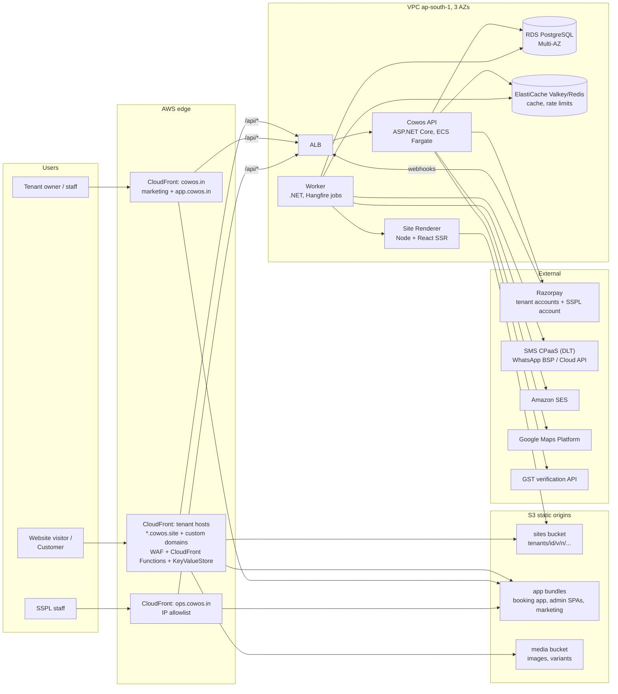
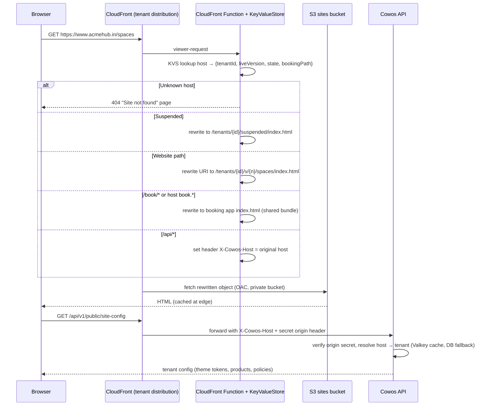
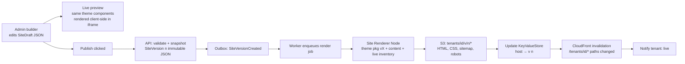
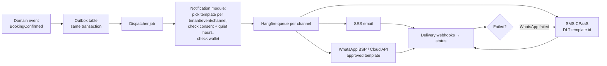
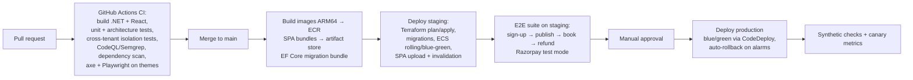

# 08 · High-Level Architecture

> Cowos requirements pack · v0.1 draft · Stack: ASP.NET Core (.NET 10 LTS), React + TypeScript, PostgreSQL, AWS (ap-south-1 Mumbai primary)

## 1. Architecture principles

1. **Shared platform, isolated data.** One deployment serves all tenants (pool model); isolation by `tenant_id` + Row-Level Security. Dedicated cells later for tenants who pay for them.
2. **Static where possible.** Tenant websites are rendered at publish time and served from the CDN. No compute per page view.
3. **Modular monolith first.** One .NET API and one worker, split into modules with enforced boundaries. Extract services only when a module has a scaling or team reason.
4. **Money paths are boring and idempotent.** Every payment-affecting operation has an idempotency key, a state machine, and a reconciliation job.
5. **Tenant context is never trusted from the client.** It comes from the host (verified at the edge) or a signed token.

## 2. System context



## 3. Deployable units

| Unit | Tech | Hosting | Notes |
|------|------|---------|-------|
| Marketing site (`cowos.in`) | React + TS, pre-rendered (Vite SSG or Next.js static export) | S3 + CloudFront | Rebuilt on content change; CMS optional (MDX files in repo for v1) |
| Tenant Admin SPA (`app.cowos.in`) | React + TS, Vite, TanStack Query, React Router, component library (e.g. shadcn/ui on Radix for accessibility) | S3 + CloudFront | Talks to API via BFF endpoints under `/api` (same origin) |
| Super Admin SPA (`ops.cowos.in`) | Same stack, separate build | S3 + CloudFront with IP allowlist / AWS Verified Access | Separate build so admin code never ships to tenants |
| Booking App | React + TS, Vite, one build for all tenants | S3 + CloudFront (tenant distribution) | Reads tenant config at boot; themed via CSS variables |
| Tenant websites | Static HTML/CSS (+ small JS) per tenant version | S3 + CloudFront (tenant distribution) | Produced by the Site Renderer |
| Cowos API | ASP.NET Core 10 Web API, EF Core 10, Npgsql | ECS Fargate, ≥2 tasks across AZs, behind ALB | Modular monolith |
| Worker | .NET 10 Worker + Hangfire (PostgreSQL storage) | ECS Fargate, ≥1 task (2 in prod) | Background and scheduled jobs |
| Site Renderer | Node.js 22 LTS + React `renderToString`, shares theme packages with admin preview | ECS Fargate task (on-demand via job queue) or Lambda container | Only Node service; stateless |
| Database | PostgreSQL 17 on RDS, Multi-AZ, gp3 | RDS | `btree_gist`, `pg_trgm`, `citext` extensions |
| Cache | ElastiCache (Valkey) | Single small node in v1 | Rate limiting, host→tenant cache, OTP throttles |

## 4. Backend modules (modular monolith)

| Module | Owns | Key collaborators |
|--------|------|-------------------|
| `Identity` | Tenant users, customers (per tenant), OTP, MFA, tokens, roles | All |
| `Tenancy` | Tenants, tenant state machine, plan limits, feature flags, tenant catalog (cell mapping) | Billing, Sites |
| `Sites` | Themes, site drafts, versions, pages, media references, publish pipeline | Renderer, Domains |
| `Domains` | Hostnames, verification, certificate status, routing table sync to edge | Sites, Tenancy |
| `Inventory` | Locations, products, units, pricing, add-ons, availability rules, holidays, tours | Booking |
| `Booking` | Availability engine, holds, bookings, requests, check-in, reschedule, cancellation | Inventory, Payments, Invoicing |
| `Payments` | Gateway connections, orders, payments, refunds, webhooks, reconciliation | Booking, Invoicing |
| `Invoicing` | Invoice series, invoices, credit notes, PDF generation, GST calculation | Payments, Booking |
| `Crm` | Customers, companies, leads, tours, notes, consent records, DPDP requests | Booking |
| `Memberships` (P2) | Plans, memberships, credit ledgers, renewals | Booking, Invoicing |
| `Promotions` | Coupons, redemptions | Booking |
| `Notifications` | Templates, dispatch, delivery tracking, wallet debits | All (via events) |
| `PlatformBilling` | Cowos plans, subscriptions, platform invoices, dunning, messaging wallet | Tenancy |
| `Audit` | Audit events, support grants | All |
| `Reporting` | Read models, exports | All (read-only) |

Rules: modules talk through public interfaces (in-process) or domain events via the transactional outbox. No module reads another module's tables directly. Enforced with architecture tests in CI.

## 5. Multi-tenancy strategy

### 5.1 Options compared

| | Shared schema + `tenant_id` + RLS | Schema per tenant | Database per tenant |
|---|---|---|---|
| Isolation | Logical (two layers: app filter + RLS) | Stronger logical boundary | Strong |
| Migrations | One migration, one schema | Run N times; drift and partial-failure handling at 1,000+ schemas | Run N times across N databases |
| Connection pooling | One pool | `search_path` per request complicates pooling; catalog bloat at thousands of schemas | Pool per DB; RDS cost per DB if separate instances |
| Cross-tenant analytics (platform metrics) | Simple SQL | UNION across schemas | ETL required |
| Per-tenant restore | Harder (selective restore runbook) | Easier (dump one schema) | Easiest |
| Cost | Lowest | Low | Highest |
| Fit for 1,500 small tenants | Best | Workable but operationally heavy | Poor (except for a few large tenants) |

### 5.2 Recommendation

**Shared schema with `tenant_id` on every tenant-owned table, enforced by PostgreSQL Row-Level Security and EF Core global query filters.** Large tenants who need it later get a **dedicated cell** (their own database with the same schema), selected through the tenant catalog. That gives the hybrid model from 00 §C2 without a second code path.

Implementation sketch:

```sql
-- Every tenant table
ALTER TABLE booking ENABLE ROW LEVEL SECURITY;
ALTER TABLE booking FORCE ROW LEVEL SECURITY;
CREATE POLICY tenant_isolation ON booking
  USING (tenant_id = current_setting('app.tenant_id')::uuid)
  WITH CHECK (tenant_id = current_setting('app.tenant_id')::uuid);
```

```csharp
// Per request/transaction: a DbConnection interceptor runs
// SELECT set_config('app.tenant_id', @tenantId, true);  -- 'true' = local to transaction
// EF Core global query filter: modelBuilder.Entity<Booking>().HasQueryFilter(b => b.TenantId == _tenant.Id);
```

- App DB role: `cowos_app` with `NOBYPASSRLS`. Platform-wide admin queries (Super Admin lists) go through a separate, narrow `cowos_platform` role used only by the platform module, on views that expose non-personal fields.
- Primary keys: UUIDv7 (time-ordered, avoids hot index pages, safe to expose). Every tenant table indexes `(tenant_id, …)` first.
- Composite foreign keys including `tenant_id` where practical, so a row can't reference another tenant's row even by bug.

## 6. Tenant resolution by hostname



- The edge routing table (host → tenant, version, state) lives in **CloudFront KeyValueStore**, updated by the `Domains`/`Sites` modules on publish, rollback, domain change, or state change. Updates propagate in seconds.
- The API trusts `X-Cowos-Host` only when the request carries the CloudFront-only origin secret header (rotated) or comes through a CloudFront VPC origin. Direct ALB access is blocked by security group (CloudFront managed prefix list).
- Same-origin `/api` on every tenant host: no CORS, host-only cookies per tenant, simpler CSP.

## 7. Custom domains and SSL automation

### 7.1 Options

| Option | How | Pros | Cons |
|--------|-----|------|------|
| **A. CloudFront SaaS Manager (multi-tenant distribution)** | One multi-tenant distribution template; each tenant domain is a "distribution tenant" with a CloudFront-managed ACM certificate validated once the tenant's CNAME points at the distribution | AWS-native, managed certificate issuance and renewal, scales to many domains, shares one config | Newer service (launched 2025): validate quotas, pricing per tenant and KeyValueStore integration in a spike |
| B. One CloudFront distribution + ACM cert per tenant | Terraform/API creates a distribution per custom domain | Well-understood | Distribution and certificate quotas need raising; slow propagation; config drift across hundreds of distributions |
| C. Self-managed TLS edge | Caddy (on-demand TLS with Let's Encrypt) or Envoy + cert-manager behind an NLB with static IPs | Full control; static IPs make apex A records possible | You operate a TLS edge (patching, scaling, rate limits from Let's Encrypt, DDoS), lose CloudFront caching unless chained |

**Recommendation:** Option A, with a sprint-0 spike to confirm limits and cost. Fallback to Option C if the spike fails. Platform subdomains (`*.cowos.site`) use one wildcard ACM certificate on the same tenant-facing setup.

### 7.2 Domain lifecycle

1. Tenant adds `acmehub.in`, chooses booking placement (`book.` subdomain or `/book`).
2. System creates a `Domain` row (status `PendingDns`) with a random TXT token; detects DNS provider by NS lookup; shows provider-specific instructions:
   - `CNAME www → <tenant-edge-target>` (e.g. `edge.cowos.site` or the distribution endpoint)
   - `CNAME book → <tenant-edge-target>` (if chosen)
   - `TXT _cowos-verify.acmehub.in → cowos-verify=<token>`
   - Apex: forwarding `acmehub.in → https://www.acmehub.in` at the registrar (guides for GoDaddy, Hostinger, BigRock, Namecheap, Cloudflare, Route 53; Cloudflare/Route 53 users can use CNAME flattening/ALIAS directly)
3. Worker polls DNS every 5 minutes (public resolvers, not cached) for up to 72 hours; on success → `Verified`.
4. Create distribution tenant / attach domain; request managed certificate → `CertPending` → `Active`.
5. Edge routing table updated; platform subdomain switches to 301 → custom domain.
6. Daily health check: DNS still points to Cowos, cert valid > 14 days. On failure → `Degraded`, tenant alerted, platform subdomain keeps serving.
7. Removal: tenant removes or account deleted → routing removed, certificate released.

Guard rails: block domains already attached to another tenant (unless TXT proves ownership again), block well-known brands/phishing patterns, limit domains per plan.

## 8. Website rendering and publish pipeline



- **Themes** are versioned React packages in the monorepo (`packages/themes/loft`, `packages/themes/metro`, ...). Each exports section components and a JSON Schema for its content. The same package powers the admin preview (client-side) and the renderer (server-side), so preview equals production.
- **Content model** is theme-independent (sections keyed by type), so switching themes keeps content.
- **Rollback** is a pointer change in KeyValueStore to an existing S3 prefix: no rebuild, live in seconds.
- **Live data on a static site:** inventory names and "from" prices are baked at build. A change to prices/inventory/hours triggers a debounced (60 s) **data refresh build** of the current version. The booking app always uses live data.
- Retain the last 20 versions in S3; older prefixes deleted by a lifecycle job.

## 9. Booking app architecture

- One React SPA bundle for all tenants (`/book/*` or `book.<domain>`). On boot it calls `/api/v1/public/site-config` (cacheable 60 s at the edge per host) for theme tokens, logo, products, policies.
- Theme tokens map to CSS custom properties (`--color-primary`, `--radius-button`, `--font-heading`), so one bundle renders any brand with no flash of unbranded content (tokens also inlined into the HTML by the CloudFront Function or a small edge-rendered `<style>` include).
- Data fetching with TanStack Query; availability polling every 30 s on the slot screen; optimistic UI never used for money operations.
- Phase 2 PWA: service worker for shell caching, web app manifest generated per tenant (name, icons, theme colour), Web Push via VAPID.

## 10. File and image storage

| Bucket | Content | Access |
|--------|---------|--------|
| `cowos-media-<env>` | Tenant uploads (originals private) and generated variants | Variants public via CloudFront with Origin Access Control; originals private |
| `cowos-sites-<env>` | Rendered tenant websites per version | Private, CloudFront OAC only |
| `cowos-apps-<env>` | SPA bundles (hashed, immutable, `Cache-Control: max-age=31536000, immutable`) | CloudFront OAC |
| `cowos-docs-<env>` | Invoices, credit notes, KYC docs, exports | Private; presigned URLs (5 min) issued after authorization; KYC with separate KMS key |

Media pipeline (worker): upload via presigned POST (size/type limited) → scan → decode/re-encode with libvips (NetVips binding; avoids ImageSharp's commercial licence threshold, confirm licensing) → strip EXIF GPS → variants 320/640/1024/1600/2400 in AVIF + WebP + JPEG → record dimensions and blurhash placeholder → available to builder.

## 11. Notifications



- Email from `"Acme Hub" <bookings@notify.cowos.site>` with `Reply-To: tenant email`; SPF/DKIM/DMARC on the sending domain. Phase 2: tenant's own sending domain with DKIM CNAMEs.
- SMS uses SSPL's DLT entity and templates with `{#var#}` for tenant name. Header (sender ID) e.g. `COWOSB`.
- WhatsApp: MVP from a Cowos number with tenant-named templates; Phase 2 tenant-owned numbers via embedded signup.
- Each send records provider message ID, cost, status; wallet debited on accepted send.

## 12. Background jobs

Hangfire on PostgreSQL in v1 (one technology, built-in retries and dashboard, easy for a .NET team). Move high-volume queues to SQS if Hangfire throughput becomes a bottleneck.

| Job | Schedule / trigger | Notes |
|-----|-------------------|-------|
| Outbox dispatcher | Continuous (every 1 s) | Publishes domain events to handlers |
| Hold expiry | Every 30 s | Releases `Held` bookings past `expires_at` |
| Request SLA expiry | Every 5 min | Auto-declines expired requests, expires payment links |
| Payment reconciliation | Hourly (last 48h) + nightly (last 7d) | Pulls gateway payments per tenant; fixes missed webhooks |
| Reminders | Every 5 min | Booking reminders per rules |
| No-show marking | Every 15 min | After grace period |
| DNS verification / health | Every 5 min (pending), daily (active) | |
| Site render / data refresh build | Event-driven | Debounced |
| Platform renewals and dunning | Daily 06:00 IST | State transitions per BRD §7.3 |
| Membership renewals (P2) | Daily | Invoices N days ahead, credit grants at cycle start |
| Data export | On request | Zips to S3, emails link |
| Retention and purge | Daily | DPDP retention, tenant deletion |
| Media processing | Event-driven | |

Every job is idempotent and tenant-scoped (sets RLS context per tenant).

## 13. Authentication and authorization

| Actor | Mechanism |
|-------|-----------|
| Tenant users | ASP.NET Core Identity + OpenIddict (OIDC server in the API), BFF pattern for the admin SPA (cookie session on `app.cowos.in`, tokens held server-side), TOTP MFA |
| Customers | Per-tenant accounts; phone/email OTP → short-lived JWT + rotating refresh cookie, host-only on the tenant host |
| SSPL staff | OIDC federation to Google Workspace / Entra ID; MFA enforced by IdP; `ops.cowos.in` restricted by IP / Verified Access |
| Service to service | IAM roles; no shared static credentials |
| Authorization | Policy-based (`[Authorize(Policy="Bookings.Refund")]`) with resource checks (tenant, location scope, refund limit) |

## 14. AWS infrastructure (production, v1)

| Component | Choice |
|-----------|--------|
| Region | ap-south-1 (Mumbai); DR backups to ap-south-2 (Hyderabad) |
| Accounts | AWS Organizations: `prod`, `staging`, `dev`, `backup`, `security/logs` |
| Network | VPC, 3 AZs, private subnets for ECS/RDS/Valkey; VPC endpoints for S3, ECR, Secrets Manager, CloudWatch to limit NAT costs |
| Compute | ECS Fargate (Graviton/ARM64 for cost): `api` (2–6 tasks), `worker` (2), `renderer` (0–N on demand) |
| Data | RDS PostgreSQL 17 Multi-AZ (db.t4g.medium → m7g.large as load grows), RDS Proxy |
| Edge | CloudFront (tenant multi-tenant distribution + platform distributions), AWS WAF, Route 53 |
| Messaging | SES (ap-south-1), external SMS/WhatsApp providers |
| Secrets | Secrets Manager + KMS (separate keys: general, payment credentials, KYC documents) |
| Observability | CloudWatch Logs/metrics, X-Ray or managed Grafana/Prometheus via OpenTelemetry, Sentry for frontends |
| IaC | Terraform (modules per environment); state in S3 with locking |

Indicative monthly base cost for production v1 (on-demand, Mumbai, Oct 2026; validate with the AWS Pricing Calculator):

| Item | USD / month |
|------|------------:|
| RDS PostgreSQL db.t4g.medium Multi-AZ + 100 GB gp3 + backups | ~150 |
| ECS Fargate ARM (api 2×0.5 vCPU/1 GB, worker 2×0.5/1, renderer on demand) | ~70 |
| ALB | ~25 |
| NAT gateway (1, plus VPC endpoints) | ~45 |
| CloudFront + S3 (first 200 tenants) | ~30–60 |
| ElastiCache Valkey (small) | ~15 |
| WAF + managed rules | ~20 |
| CloudWatch logs/metrics | ~30 |
| Cross-region backup copies, KMS, Secrets Manager, Route 53 | ~25 |
| **Total** | **~410–440 (≈ ₹35,000–37,000)** |

At 200 tenants that is ≈ ₹180 per tenant per month before messaging; at 500 tenants ≈ ₹90 (with a modest DB upgrade). Staging adds ~30–40% of production if kept running; schedule it to scale down outside office hours.

## 15. CI/CD



- Monorepo layout:

```
/src
  /Cowos.Api                 # ASP.NET Core host
  /Cowos.Worker              # Hangfire worker host
  /Modules/<Module>          # Domain, Application, Infrastructure per module
  /Cowos.SharedKernel
/web
  /apps/marketing  /apps/admin  /apps/ops  /apps/booking
  /packages/ui  /packages/themes/*  /packages/site-schema  /packages/api-client
/renderer                    # Node site renderer
/infra                       # Terraform
/tests                       # integration, isolation, e2e (Playwright)
/docs/requirements           # this pack
```

- API client for React generated from OpenAPI (e.g. `openapi-typescript` / Orval) so frontend and backend contracts stay in sync.
- Database migrations: EF Core migration bundles run as a one-off ECS task before the new version takes traffic; expand/contract pattern for breaking changes.
- Theme releases: visual regression (Playwright screenshots on 3 viewports × all themes × sample tenants), accessibility checks, Lighthouse CI budgets. Existing tenants are moved to a new theme version only on their next publish, or via a controlled "rebuild all" job.
- Feature flags (per tenant/plan) for gradual rollout.
