# 09 · Data Model

> Cowos requirements pack · v0.5 draft · Logical model for PostgreSQL. All tenant-owned tables carry `tenant_id` (RLS-enforced). IDs are UUIDv7. Timestamps `timestamptz` in UTC. Money as `numeric(12,2)` in INR with `currency char(3)` for future markets.

## 1. Entity overview by module

| Module | Entities |
|--------|----------|
| Tenancy | Tenant, TenantSettings, TenantStateHistory, Cell (tenant catalog) |
| Identity | TenantUser, TenantUserRole, TenantUserLocation, TenantUserInvitation, Customer, CustomerIdentity (phone/email), OtpChallenge, PlatformUser |
| Sites | Theme, ThemeVersion, Site, SiteDraft, SiteVersion, Page, MediaAsset, MediaVariant, EdgeSync (`edge_sync` outbox) |
| Domains | Domain, DomainVerification, CertificateStatus |
| Inventory | Location, OperatingHours, Holiday, Amenity, LocationAmenity, Product, ProductUnit (Resource), PriceRule, AddOn, AvailabilityRule, MaintenanceBlock, TourSlotRule, SeatMap (Pricing Rule #13) |
| Booking | Booking, BookingAllocation, BookingAddOn, BookingEvent, DayCapacityLedger, CheckIn, BookingPass, CheckInCode |
| Policies | CancellationPolicy, CancellationTier, PolicyDocument |
| Payments | PaymentGatewayAccount, PaymentOrder, Payment, Refund, OfflinePayment, WebhookEvent |
| Invoicing | InvoiceSeries, Invoice, InvoiceLine, CreditNote, CreditNoteLine, TaxProfile |
| CRM | Company, CompanyMember, Lead, LeadActivity, Tour, Note, ConsentRecord, DataRightsRequest, SecurityDeposit |
| Memberships (P2) | MembershipPlan, Membership, CreditLedgerEntry |
| Promotions | Coupon, CouponRedemption |
| Notifications | NotificationTemplate, NotificationMessage, MessagingWallet, WalletTransaction. PilotMessagingUsage: Removed in v0.3 (pilot fair-use caps removed) |
| Platform billing | Meter (enum), UsageDaily, MonthlyMeterCount, BillingProfile, ServerInvoice, ServerInvoiceLine, PlatformPayment. CostPool, TenantCostShare, HostingInvoice, AdjustmentLine, UsageRecord and the pricing JSON: Removed in v0.3 (metered slab pricing, Pricing Rules #3 to #5, #10). PlatformPlan, PlatformPlanVersion, PlatformSubscription and PlatformInvoice: Removed in v0.2 (D1, R2) |
| Platform admin | DemoRequest, RateCardVersion, RateSlab, PlatformCostMonth (platform schema, outside tenant RLS) |
| Audit & support | AuditEvent, SupportGrant, SupportTicketRef. PreHandoverGrant: Removed in v0.3 (R19 removed with the pilot programme) |

## 2. Core relationships

```mermaid
erDiagram
    TENANT ||--o{ DOMAIN : has
    TENANT ||--|| SITE : owns
    TENANT ||--o{ LOCATION : operates
    TENANT ||--o{ TENANT_USER : employs
    TENANT ||--o{ CUSTOMER : serves
    TENANT ||--o{ COMPANY : bills
    TENANT ||--o{ PAYMENT_GATEWAY_ACCOUNT : connects
    TENANT ||--o| BILLING_PROFILE : "pays via"
    TENANT ||--o{ SERVER_INVOICE : billed
    TENANT ||--o{ USAGE_DAILY : "metered as"
    TENANT ||--o{ MONTHLY_METER_COUNT : "counts messages in"
    TENANT ||--o{ EDGE_SYNC : "queues edge updates"
    TENANT }o--|| CELL : "placed in"

    SITE }o--|| THEME_VERSION : uses
    SITE ||--|| SITE_DRAFT : edits
    SITE ||--o{ SITE_VERSION : publishes
    SITE ||--o{ MEDIA_ASSET : stores

    LOCATION ||--o{ PRODUCT : offers
    LOCATION ||--o{ HOLIDAY : closes
    LOCATION ||--o{ OPERATING_HOURS : opens
    PRODUCT ||--o{ PRODUCT_UNIT : contains
    PRODUCT ||--o{ PRICE_RULE : priced_by
    PRODUCT ||--o{ ADD_ON : extends
    PRODUCT }o--|| CANCELLATION_POLICY : governed_by
    PRODUCT ||--o{ AVAILABILITY_RULE : constrained_by

    CUSTOMER ||--o{ BOOKING : makes
    COMPANY ||--o{ COMPANY_MEMBER : includes
    CUSTOMER ||--o{ COMPANY_MEMBER : "is"
    BOOKING }o--|| PRODUCT : for
    BOOKING ||--o{ BOOKING_ALLOCATION : reserves
    BOOKING_ALLOCATION }o--o| PRODUCT_UNIT : on
    BOOKING ||--o{ BOOKING_ADD_ON : includes
    BOOKING ||--o{ PAYMENT_ORDER : paid_via
    PAYMENT_ORDER ||--o{ PAYMENT : results_in
    PAYMENT ||--o{ REFUND : refunded_by
    BOOKING ||--o{ INVOICE : invoiced_by
    INVOICE ||--o{ INVOICE_LINE : has
    INVOICE ||--o{ CREDIT_NOTE : adjusted_by
    INVOICE }o--|| INVOICE_SERIES : numbered_in
    BOOKING }o--o| COUPON : applies
    BOOKING }o--o| MEMBERSHIP : "uses credits of"

    CUSTOMER ||--o{ MEMBERSHIP : holds
    MEMBERSHIP }o--|| MEMBERSHIP_PLAN : on
    MEMBERSHIP ||--o{ CREDIT_LEDGER_ENTRY : tracks

    TENANT ||--o{ LEAD : receives
    LEAD ||--o{ TOUR : schedules
    LEAD }o--o| CUSTOMER : converts_to

    RATE_CARD_VERSION ||--o{ RATE_SLAB : "priced by"
    SERVER_INVOICE }o--|| RATE_CARD_VERSION : "rated with"
    SERVER_INVOICE ||--o{ SERVER_INVOICE_LINE : has
    BOOKING ||--o| BOOKING_PASS : "shown as"
    TENANT ||--|| MESSAGING_WALLET : funds
```



## 3. Key entities and attributes

### 3.1 Tenancy and identity

**Tenant**
| Field | Type | Notes |
|-------|------|-------|
| id | uuid | |
| slug | citext unique | Platform subdomain; reserved list enforced |
| brand_name, legal_name | text | |
| entity_type | enum | Proprietorship, Partnership, LLP, PvtLtd, Other |
| gstin | text null | Validated format + checksum; unique among active tenants |
| pan | text null | |
| state_code | char(2) | From GSTIN or address; drives tax |
| state | enum | Trial, Active, PastDue, Restricted, Suspended, SuspendedByAdmin, Expired, Cancelled, PendingDeletion, Deleted. All states are in use from launch (BRD §7.3, Pricing Rules #7, #8) |
| trial_ends_at, state_changed_at | timestamptz | trial_ends_at = sign-up + 14 days (Pricing Rule #7) |
| is_pilot | Removed in v0.3 (pilot programme removed) | |
| free_period_ends_at | Removed in v0.3 (no free year) | |
| unconverted_restricted_until | Removed in v0.3 (unconverted-pilot Restricted rule removed) | |
| data_seq | bigint | Increments in the same transaction as every website-visible data change (inventory names, prices, hours) and every tenant state change; compared by data-refresh renders (R18) |
| first_online_booking_at | timestamptz null | Set atomically with the first paid online booking confirmation, so the first-booking message sends once (14A, F-RR-C2) |
| goal | enum | FullSite, BookingOnly (booking-only path in the onboarding wizard, CEO-S2) |
| cell_id | uuid | Tenant catalog (pool-1 by default) |
| kyc_status | enum | NotStarted, Pending, Verified, Rejected |
| first_publish_approved_at | timestamptz null | |
| referral_code, referred_by_code, utm | text / jsonb | Captured at public sign-up (FR-MW-006) |
| timezone | text | Default `Asia/Kolkata` |
| currency | char(3) | Default INR |

**TenantStateHistory** (eng review 5, D2): id, tenant_id, state, valid_from (timestamptz), valid_to (timestamptz null while current), reason, actor (user or system job), event_id (the TenantStateChanged event). One row is closed and one opened in the same transaction as every state change and its TenantStateChanged event; an exclusion constraint on (tenant_id, tstzrange(valid_from, valid_to)) keeps a tenant's periods from overlapping. MonthlyRating counts billable days (Active, PastDue, Restricted, by IST day) from it for the Fixed plan fee and the R3-E1 missing-plan check.

Tenant state transitions (TrialEnded added by the eng re-review, D2: day 15 without a plan → TrialEnded; day 45 → Suspended; plan chosen → Active): self-serve sign-up → Trial (14 days, platform subdomain only, server usage not rated); payment method added → Active; unpaid server invoice → PastDue, Restricted and Suspended per BRD §7.3 (Pricing Rules #7, #8). Each transition has a test. The pilot transitions of v0.2 are Removed in v0.3.

**TenantUser**: id, tenant_id, email (citext), phone, name, password_hash, mfa_secret (encrypted), mfa_enabled, role (Owner, Manager, Staff), status, last_login_at. **TenantUserLocation**: tenant_user_id, location_id (scope).

**TenantUserInvitation** (FR-TA-172): id, tenant_id, email, phone, role (Manager, Staff), location_ids, token_hash, invited_by (tenant user), expires_at, accepted_at null, revoked_at null (a resend revokes the previous invitation). Single use. Owners are not invited; they register at sign-up (Pricing Rule #9).

**Customer** (per tenant): id, tenant_id, name, phone_e164, email, gstin, billing_address (jsonb), marketing_consent (derived from latest ConsentRecord), status (Active, Blocked, Anonymised), created_via (Online, Staff, Import), last_activity_at. Unique (tenant_id, phone_e164) and (tenant_id, email) where not null.

**Company**: id, tenant_id, name, gstin, billing_address, admin_customer_id, credit_terms_days, notes. **CompanyMember**: company_id, customer_id, role (Admin, Member), can_bill_to_company.

**PlatformUser** (SSPL staff): id, idp_subject, email, role (SuperAdmin, Support, Finance), status.

### 3.2 Sites and domains

**Theme / ThemeVersion**: theme key, name, version (semver), package reference, content JSON schema, supported sections, booking shell chunk reference (16A, R13), status (Hidden, Active, Deprecated). Every theme is available to every tenant; there are no plans (D1). Hidden keeps a new theme out of the catalog until its Lighthouse, axe and screen reader checks pass (CEO-S3).

**Site**: id, tenant_id, theme_version_id, live pointer (`live_version_id` null, `live_data_seq` null), booking_placement (Subdomain, Path), branding (jsonb: logo asset ids, colours, font pair, button shape, mode). The pointer changes only at the render switch step: owner publish and rollback set it (blocked while Suspended); a data refresh sets it only if `live_version_id` is unchanged and its `data_seq` is higher than `live_data_seq` (CEO-A1, CEO-A3, R18). Every pointer change adds an EdgeSync row in the same transaction (R17).

**EdgeSync** (`edge_sync` outbox, R17): id, tenant_id, reason (Publish, Rollback, DataRefresh, StateChange, Domain, TenantCreated), enqueued_at, sent_at null. Added in the same transaction as every change to a tenant's live pointer, state or hostnames. The single EdgeSyncWorker reads unsent rows, then reads the tenant's current pointer and state from the DB and writes them to KVS; it marks the rows sent. Partial index on `enqueued_at` WHERE `sent_at IS NULL`; alert when the oldest unsent row is older than 2 minutes.

**SiteDraft**: site_id, content (jsonb, theme-independent sections), updated_at, updated_by, revision (optimistic concurrency).

**SiteVersion** (immutable): id, site_id, number (int, increments), content snapshot (jsonb), branding snapshot, theme_version_id, status (Rendering, Live, Superseded, Failed), s3_prefix, published_by, published_at, note, rolled_back_from_version_id null.

**MediaAsset**: id, tenant_id, original_key, mime, width, height, bytes, alt_text, blurhash, scan_status, variants (jsonb), usage_count.

**Domain**: id, tenant_id, hostname (citext unique globally), purpose (Website, Booking, WebsiteAndBooking, Redirect), is_platform (bool), status (PendingDns, Verified, CertPending, Active, Degraded, Removed), verification_token, last_checked_at, dns_provider_detected, cert_expires_at, edge_tenant_ref.

### 3.3 Inventory

**Location**: id, tenant_id, name, slug, address (jsonb), lat, lng, directions, gst_registration_id (for multi-state), timezone, contact phone/email, is_24x7, status.

**OperatingHours**: location_id, day_of_week, opens_at, closes_at (multiple rows for split shifts). **Holiday**: location_id, date, name, closed_all_day or partial hours.

**Product** (what is sold)
| Field | Notes |
|-------|-------|
| id, tenant_id, location_id | |
| type | HotDesk, DedicatedDesk, PrivateCabin, MeetingRoom, EventSpace, VirtualOffice, Custom |
| inventory_model | Pool (capacity count) or Unit (specific resources) |
| name, slug, description, photos (media ids), amenities | |
| booking_mode | Instant, Request, Enquire |
| visibility | Public, MembersOnly, Hidden |
| capacity_per_unit | Seats (rooms/cabins) |
| pool_capacity | For Pool model (seats per day). When seat_choice is not Off, derived from the product's active Seat units and read-only |
| seat_choice | HotDesk only: Off (plain pool), Optional, Required (FR-TA-068b). Optional or Required makes availability and allocation work per Seat unit, so every booking holds a specific seat |
| slot_granularity_min, min_duration_min, max_duration_min | |
| buffer_before_min, buffer_after_min, lead_time_min, advance_window_days | |
| tax: sac_code (default 997212), gst_rate (default 18.00), price_includes_tax | |
| cancellation_policy_id, request_sla_hours | |
| security_deposit_amount | Monthly products |
| convenience_fee_type, convenience_fee_value | Optional tenant fee (None, Flat, Percent); goes to the tenant |
| is_sample | Demo inventory labelled "Sample"; pre-publish checks block publishing while any sample item remains (4A, F-RR-C2; demo inventory in the onboarding wizard, CEO-S2) |

**ProductUnit** (Resource): id, tenant_id, product_id, label ("Cabin 3", "D-12", "A3"), capacity, floor, zone, kind (Seat, Room), status (Active, Maintenance, Retired), out_of_service_reason, tags (text[]: window, power, monitor, standing, custom). Placement on a seat map: seat_map_id null, grid_row, grid_col, grid_row_span, grid_col_span (1 × 1 for a seat). The v0.3 floor_plan_x/y (P2) fields are removed. Seat labels are unique per location, checked on map publish (FR-TA-068a).

**SeatMap** (Pricing Rule #13, FR-TA-068): id, tenant_id, location_id, name ("Ground floor · Main hall"), rows (≤ 40), cols (≤ 60), sort_order, draft_layout (jsonb), live_layout (jsonb null), live_version (int, 0 before the first publish), published_at, published_by, template_key null, archived_at. Layout jsonb holds the non-unit cells as `{row, col, kind: Aisle|Wall|Entrance|Label, text}` and, in the draft only, the planned seat and block placements; live seats and blocks are read from ProductUnit placement, so a booking never points at a cell. At most 10 active maps per location (FR-TA-068d). One table instead of SeatMap + SeatMapVersion (eng review 5, D1).

**Added in v0.5 (00 §C15–C19; proposed, not through the eng review):**
- **Floor**: id, tenant_id, location_id, name ("Ground floor"), sort_order, plan_media_id null (the uploaded plan), plan_crop and plan_rotation, archived_at. SeatMap gains floor_id, and plan_transform (jsonb: cell size, offset, scale, opacity) for lining the plan up with the grid (FR-TA-068g, FR-TA-068h).
- **SeatType**: id, tenant_id, location_id, name, colour, shape (None, OneSide, TwoSides, Cubicle), description, photo_media_id null, is_default, sort_order, archived_at. ProductUnit gains seat_type_id (seats only). PriceRule gains applies_to_seat_type_id null, next to applies_to_unit_id; price lookup order is unit, then seat type, then product (FR-TA-068i, FR-TA-068j).
- **Amenity**: id, tenant_id, location_id, name, icon_key, note, is_paid, is_enabled, sort_order, starter_key null (set for entries from the Cowos starter list). LocationAmenity and a product-to-amenity link hold where each applies (FR-TA-072).
- **Booking** gains renewed_from_booking_id null, check_in_code (6 digits, unique per location and day), checked_in_at and check_in_override_reason null. Location gains check_in_opens_minutes (default 10). Product gains renewals_enabled and renewal_alert_timings (jsonb per duration) (FR-BA-038, FR-BA-046, FR-TA-083, FR-TA-084).
- **PlatformOfferCode**: id, code, discount_pct, covers (PlanFee, ServerUsage, Notifications), months, max_redemptions, redeem_by, status. **PlatformOfferRedemption**: code_id, tenant_id, redeemed_at, starts_on, ends_on, attached_by null, removed_at, removed_reason. Not tenant-owned tables (FR-SA-059, FR-TA-183).

**SeatMapVersion**: Not used (eng review 5, D1). Publishing copies draft_layout to live_layout, increments live_version, copies unit placements to ProductUnit, checks the publish rules (FR-TA-068c) and bumps `tenant.data_seq` (R18), all in one transaction. Each publish writes an AuditEvent holding the replaced live_layout, which is the map's history.

**PriceRule**: id, product_id, unit (Hour, HalfDay, Day, Week, Month), amount, member_amount null, applies_to_unit_id null (unit-specific price), valid_from, valid_to, peak rules (P2: days_of_week, time window, multiplier).

**AddOn**: id, product_id, name, amount, basis (PerBooking, PerHour, PerPerson), max_qty, stock null.

**AvailabilityRule**: product_id or unit_id, days_of_week, start_time, end_time (overrides location hours). **MaintenanceBlock**: unit_id, during (tstzrange), reason.

**TourSlotRule**: location_id, days_of_week, start, end, slot_minutes, parallel_tours.

### 3.4 Booking

**Booking**
| Field | Notes |
|-------|-------|
| id, tenant_id, reference (human-readable, e.g. `WL-7K3D9`) | |
| customer_id, company_id null, bill_to (Customer, Company) | |
| product_id, location_id | |
| status | Requested, Held, AwaitingPayment, Confirmed, CheckedIn, Completed, Cancelled, NoShow, Expired, Declined |
| source | Online, Staff, Widget, Import |
| starts_at, ends_at | Customer-facing period |
| quantity | Seats (pool) |
| price_snapshot | jsonb: unit prices, add-ons, discounts, tax split, totals (frozen at booking) |
| subtotal, discount, taxable_value, tax_amount, total | |
| coupon_id, membership_id (credits) | |
| hold_expires_at | For Held |
| payment_link_expires_at | For AwaitingPayment |
| cancellation_policy_snapshot | jsonb (policy at time of booking applies, not current policy) |
| cancelled_at, cancelled_by, cancel_reason, refund_amount_policy, refund_amount_final | |
| notes_customer, notes_internal | |
| idempotency_key | Unique per tenant |

**BookingAllocation** (what is actually blocked)
| Field | Notes |
|-------|-------|
| id, tenant_id, booking_id | |
| unit_id | For Unit-model products, and for HotDesk products whose seat_choice is not Off (the Seat unit; "Any available seat" picks one at hold time) |
| blocked_during | tstzrange including buffers |
| active | Boolean, true while booking status blocks inventory |

Double-booking prevention for unit products:

```sql
CREATE EXTENSION IF NOT EXISTS btree_gist;
ALTER TABLE booking_allocation
  ADD CONSTRAINT booking_allocation_no_overlap
  EXCLUDE USING gist (tenant_id WITH =, unit_id WITH =, blocked_during WITH &&)
  WHERE (active);
```

**DayCapacityLedger** (pool products with Seat choice Off): tenant_id, product_id, date, capacity, booked (int), with `CHECK (booked <= capacity)`. It is the capacity source only while the product's Seat choice is Off. When a map publish turns seats on, the same transaction (after the R3-A1 seat assignment) deletes that product's ledger rows and free seats in BookingAllocation become the only source; turning seats back off rebuilds the rows from active allocations in one transaction (eng review 5, D3). Holds increment `booked` in the same transaction (`UPDATE ... SET booked = booked + :qty WHERE booked + :qty <= capacity`), so overselling is impossible under concurrency.

**BookingEvent**: booking_id, type (Created, Held, PaymentStarted, Paid, Confirmed, Rescheduled, Cancelled, RefundIssued, CheckedIn, NoShow, NotificationSent), actor (customer/staff/system/support), data (jsonb), at.

**CheckIn**: booking_id, checked_in_at, method (QR, Manual, Self), by_user_id.

**BookingPass** (desk pass link, 17A, R10): id, tenant_id, booking_id, token_hash, purpose (`pass`), expires_at (booking end), revoked_at null (set on cancel or reschedule). The link token is opaque, carries no personal data and is HMAC-bound to booking id + purpose. The pass page shows only first name + last initial, date/time, room and tenant logo.

**CheckInCode** (QR on the pass, R10): id, tenant_id, booking_id, code_hash, expires_at (short-lived). Separate from the pass token. The front desk scan validates it against the scanning tenant only.

### 3.5 Policies

**CancellationPolicy**: id, tenant_id, name, product_type default, no_show_refund_pct, deduct_gateway_fee (bool), allow_credit_instead (bool), credit_bonus_pct, reschedule_allowed_until_hours, free_text. **CancellationTier**: policy_id, min_hours_before, refund_pct (ordered).

**PolicyDocument**: tenant_id, kind (Privacy, Terms, HouseRules, Refund), version, content, published_at.

### 3.6 Payments

**PaymentGatewayAccount**: id, tenant_id, provider (Razorpay, Cashfree, PhonePe), connection_type (OAuth, ApiKey), account_ref, display_name, mode (Test, Live), credentials_ciphertext (KMS envelope), token_expires_at, status (Connected, Error, Disconnected), last_health_check_at.

**PaymentOrder**: id, tenant_id, booking_id or invoice_id, gateway_account_id, provider_order_id, amount, status (Created, Attempted, Paid, Expired), idempotency_key.

**Payment**: id, tenant_id, order_id, provider_payment_id (unique), method (UPI, Card, Netbanking, Wallet, EMI), method_detail_masked, amount, fee, tax_on_fee, status (Authorized, Captured, Failed, Refunded, PartiallyRefunded), captured_at, raw (jsonb, no card data).

**OfflinePayment**: id, tenant_id, booking_id/invoice_id, method (Cash, UpiDirect, BankTransfer, Cheque), reference, amount, received_at, recorded_by.

**Refund**: id, tenant_id, payment_id null, booking_id, amount, destination (Original, Credit), provider_refund_id, status (Pending, Processed, Failed), reason, initiated_by, override (bool).

**WebhookEvent**: id, provider, provider_event_id (unique), tenant_id (resolved from account), type, signature_valid, payload (jsonb), received_at, processed_at, error.

### 3.7 Invoicing

**TaxProfile** (per tenant/location GST registration): gstin, legal name, address, state_code.

**InvoiceSeries**: id, tenant_id, location_id, kind (Invoice, CreditNote, BillOfSupply), prefix, financial_year ('2026-27'), next_number. Number allocation via `UPDATE ... RETURNING` in the invoice transaction (gap-free; max 16 characters total).

**Invoice**: id, tenant_id, series_id, number, issue_date, supplier snapshot (jsonb), buyer snapshot (name, address, GSTIN, state), place_of_supply_state, invoice_type (B2B, B2C, BillOfSupply), booking_id/membership_id, subtotal, discount, taxable_value, cgst, sgst, igst, total, amount_paid, status (Issued, PartiallyPaid, Paid, Void), pdf_key. Immutable after issue (only status and paid amounts change).

**InvoiceLine**: invoice_id, description, sac_code, quantity, unit, rate, discount, taxable_value, gst_rate, cgst, sgst, igst.

**CreditNote / CreditNoteLine**: same shape, references invoice_id, reason.

### 3.8 CRM and compliance

**Lead**: id, tenant_id, source (WebsiteForm, Enquiry, Tour, Walkin, Phone, Import, Widget), name, phone, email, company_name, interest_product_id, team_size, budget, move_in_date, stage (New, Contacted, TourScheduled, TourDone, Proposal, Won, Lost), lost_reason, owner_user_id, next_follow_up_at, customer_id (when converted). **LeadActivity**: lead_id, type (Call, WhatsApp, Email, Note, StageChange), data, by, at.

**Tour**: id, tenant_id, lead_id, location_id, scheduled_at, status (Scheduled, Done, NoShow, Cancelled), host_user_id.

**ConsentRecord**: id, tenant_id, customer_id or lead_id, purpose (Marketing_WhatsApp, Marketing_SMS, Marketing_Email, Analytics), granted (bool), notice_version, channel (Web, Staff, WhatsApp reply), captured_at, ip_hash.

**DataRightsRequest**: id, tenant_id, customer_id, type (Access, Correction, Erasure, Grievance, Nomination), status, due_at, handled_by, completed_at, notes.

**SecurityDeposit**: id, tenant_id, customer/company, booking/membership, amount, collected_via, status (Held, PartiallyRefunded, Refunded, Forfeited), deductions (jsonb).

### 3.9 Memberships (Phase 2) and promotions

**MembershipPlan**: id, tenant_id, location_id, name, price, cycle (Monthly, Quarterly, Annual), included_product_id, included_credit_minutes, credit_products (list), member_discount_pct, access_hours, deposit_amount, notice_days, rollover_cap_minutes, visibility.

**Membership**: id, tenant_id, plan_id, customer_id or company_id, assigned_unit_id, starts_on, current_cycle_start/end, status (Active, Paused, NoticeGiven, Ended), next_invoice_on.

**CreditLedgerEntry**: id, tenant_id, membership_id, change_minutes (+/−), reason (CycleGrant, BookingUse, Expiry, Adjustment, Refund), booking_id null, at. Balance = sum.

**Coupon** (tenant promo code): id, tenant_id, code (citext, unique per tenant), type (Percent, Flat), value, max_discount, min_order, valid_from/to, total_limit, per_customer_limit, product_ids, location_ids, first_booking_only, visibility (Public, Private), banner_text, status (Active, Paused, Expired, Archived), created_by. **CouponRedemption**: coupon_id, booking_id, customer_id, discount_amount.

### 3.10 Notifications

**NotificationTemplate**: id, tenant_id null (platform default), event, channel (Email, Sms, WhatsApp), locale, subject, body, provider_template_id (DLT/WhatsApp), category (Utility, Authentication, Marketing).

**NotificationMessage**: id, tenant_id, recipient (customer/user id + masked address), event, channel, meter (OtpSms, Sms, WhatsApp, Email), template_id, status (Queued, Sent, Delivered, Read, Failed), provider_message_id, cost (provider cost, for the SSPL cost view only), price_charged (slab price debited from the wallet), rate_card_version_id, month_count (the month-to-date count this message took), error, related_entity, created_at (Pricing Rules #3, #6, #10).

**MessagingWallet**: tenant_id, balance. Prepaid by the tenant (Pricing Rule #6). Each message is debited at the slab price for its channel's meter, based on the tenant's month-to-date count, under the rate card version in force. Floors (R4): an SMS or WhatsApp notification debit needs `balance - price >= 0`; an OTP or email debit needs `balance - price >= -500` (₹). Each send runs one transaction: increment MonthlyMeterCount, look up the slab price for the new count, then one conditional `UPDATE messaging_wallet SET balance = balance - :price WHERE tenant_id = :t AND balance - :price >= :floor RETURNING balance`; if no row returns, an SMS or WhatsApp notification goes by email instead and the count increment rolls back. What stops at the −₹500 floor is open (Open Question 4). `CHECK (balance >= -500)`.

**WalletTransaction**: tenant_id, amount (+top-up / −usage), kind (TopUp, Notification, Otp, Adjustment), meter null, message_id null, top_up_payment_id null, at. Written in the same transaction as the wallet debit and the count increment (R4).

**PilotMessagingUsage**: Removed in v0.3 (pilot fair-use caps removed; month-to-date counts are in MonthlyMeterCount).

### 3.11 Platform billing

Each tenant is on one of two plans per calendar month (Pricing Rule #12): Fixed (flat fee, unlimited server usage, messages within allowances, then wallet) or Usage (server request units and server storage units invoiced monthly in arrears, and notification units debited from the prepaid wallet, each meter priced in telescopic slabs from the rate card, §3.11A) (D1, Pricing Rules #3 to #6). These tables ship at launch. TenantPlanPeriod, UsageDaily, MonthlyMeterCount, ServerInvoice and ServerInvoiceLine are tenant-owned and RLS-enforced; the rating job writes them one tenant per transaction (R3).

**TenantPlanPeriod** (Rule #12): id, tenant_id, plan (Fixed, Usage), starts_on (date: the activation date, or the 1st of a month), ends_on null, chosen_by (user), chosen_at. One open period per tenant; a scheduled switch closes the current period on the last day of the month and opens the next on the 1st. Unique (tenant_id, starts_on); periods never overlap (exclusion constraint on the date range).

**Meter** (enum, Pricing Rule #3): ServerRequests (1 unit = 1,000 requests), ServerStorage (1 unit = 1 GB-month), OtpSms, Sms, WhatsApp, Email (1 unit = 1 message each). ServerRequests and ServerStorage are invoiced; the four notification meters are debited from the wallet.

**UsageDaily**: tenant_id, meter, date (IST day), quantity (raw measure: requests counted, bytes stored at the daily snapshot, or messages sent), units (numeric: requests ÷ 1,000; GB stored that day; messages), source (CloudFrontLogs, StorageSnapshot, NotificationSend; R22), computed_at. Unique (tenant_id, meter, date); a re-run for a day replaces the row (NFR-MTR-05). Request rows exclude WAF-blocked requests and SSPL monitoring (NFR-MTR-03). A month's storage units are the average of its daily rows. Retained at least as long as the invoice or wallet debits they support, so the tenant sees the daily detail behind an invoice (NFR-MTR-01).

**MonthlyMeterCount**: tenant_id, meter (notification meters), month (IST), count. Unique (tenant_id, meter, month). Incremented in the same transaction as the wallet debit (R4); the new count picks the slab price. A new row starts each calendar month in IST (Pricing Rules #4, #6).

**BillingProfile**: id, tenant_id (unique), billing contact email, GSTIN snapshot for the invoice, payment_method (PaymentLink, UpiAutopay, EMandate), mandate_ref null, mandate_max_amount null (at most ₹5,000; RBI pre-debit notice applies), paid_by_sspl (bool: SSPL test and demo tenants), status. Created at sign-up; a tenant becomes Active when it adds a payment method (Pricing Rule #7).

**ServerInvoice**: id, tenant_id, number (`CW/26-27/000123`), month (IST calendar month), rate_card_version_id, taxable_value, cgst, sgst, igst (SSPL state vs tenant state), total, status (Issued, Paid, Overdue, Void), issued_at (1st of the next month), due_at (issued_at + 10 days), paid_at, payment_link_ref, pdf_key. Unique (tenant_id, month). Immutable after issue like tenant invoices; reproducible from UsageDaily and the recorded rate card version (NFR-MTR-02). Usage in Trial is not rated (Pricing Rules #5, #7).

**ServerInvoiceLine**: server_invoice_id, line_type (FixedPlan, Meter), meter null (ServerRequests, ServerStorage), units (billable days for FixedPlan), slab_breakdown (jsonb, Meter lines: per slab from_unit, to_unit, units, price_per_unit, amount), amount. A Fixed plan month has one FixedPlan line; a Usage plan month has one line per server meter (Pricing Rules #5, #12).

**PlatformPayment**: server_invoice_id null or wallet top-up, provider ids, method (PaymentLink, UpiAutopay, EMandate), amount, status.

**CostPool, TenantCostShare, AdjustmentLine**: Removed in v0.3 (no AWS-cost split; CUR feeds only the SSPL cost view, Pricing Rule #10).

**HostingInvoice**: Removed in v0.3 (replaced by ServerInvoice, Pricing Rule #5).

**UsageRecord**: Removed in v0.3 (replaced by UsageDaily, which is billed).

**Pricing JSON**: Removed in v0.3 (the pricing page shows the current rate card, Pricing Rule #4).

**PlatformPlan / PlatformPlanVersion**: Removed in v0.2 (no plans, prices, limits or feature tiers; every tenant gets every feature; D1, R2).

**PlatformSubscription**: Removed in v0.2. In v0.4 the tenant's plan is recorded in TenantPlanPeriod (Pricing Rule #12); prices come from RateCardVersion.

**PlatformInvoice**: Removed in v0.2 (SSPL's tenant invoice is now ServerInvoice).

### 3.11A Platform admin

**RateCardVersion** (Pricing Rules #4, #12): id, number, effective_from (date, always the 1st of a month, IST), fixed_plan_fee (₹ per month, excluding GST), fixed_allowance (jsonb: monthly included messages per channel: OtpSms, OtherSms, WhatsApp, Email), status (Draft, Published), published_by (platform user), published_at, note. Platform schema, outside tenant RLS; edited and published only by Super Admin. Unique (effective_from) among published versions. A published version and its slabs never change; a price change is a new version effective from the 1st of a later month (NFR-MTR-02). The version in force for a month is the latest published version with `effective_from` on or before the 1st of that month. The notice period before a new version takes effect is open (Open Question 5).

**RateSlab**: id, rate_card_version_id, meter, from_unit, to_unit null (null = no upper bound), price_per_unit (₹, may be 0 for a free allowance). Each meter in a version has a complete slab table: the first slab starts at 0, slabs are contiguous with no overlap, and the last is open-ended. Applied telescopically: units in slab 1 at the slab-1 price, the next units at the slab-2 price, and so on (Pricing Rule #4).

**PlatformCostMonth** (Pricing Rule #10): month, aws_cost (net of credits, production account, from CUR 2.0), aws_bill_final (bool: CUR 2.0 `bill_invoice_id` populated), service_breakdown (jsonb: AWS cost by service category), messaging_provider_cost (jsonb: sum of NotificationMessage.cost per channel), loaded_at. Platform schema, readable by Super Admin (and Finance, view only). The cost view shows it next to billed revenue for the month (server invoices and wallet debits), computed on demand. Never an input to a tenant bill.

**DemoRequest** (Book-a-demo form, CEO-A2; was PilotRequest): id, name, phone_e164, email, space_name, city, seats, aggregators_used, message (plain text, ≤ 2,000 characters), status, notify_status (Pending, Sent, Failed), ip_hash, created_at, updated_at. Platform schema, outside tenant RLS, readable only by the Super Admin role. Saved before sales is notified through the email outbox. A second request from the same phone within 24 hours updates the existing row and sends one notification. Retained 12 months.

Tenant scorecard (CEO-A4, R20): covers all live tenants; computed on demand, not stored. A paid online booking is customer-made in the booking app (`source = Online`), has a captured payment and is not fully refunded; staff-created and offline bookings are excluded. It counts in the month its payment was captured, in Asia/Kolkata time; a later full refund removes it from that month and past months recompute. The page shows "as of <time>".

### 3.12 Audit and support

**AuditEvent** (append-only): id, tenant_id null (platform events), actor_type, actor_id, impersonated_by null, action (e.g. `pricing.updated`, `refund.override`), entity_type, entity_id, before (jsonb), after (jsonb), ip, user_agent, at. Partitioned by month.

**SupportGrant**: id, tenant_id, requested_by (platform user), ticket_ref, reason, access (ReadOnly, ReadWrite), status (Requested, Approved, Denied, Revoked, Expired), approved_by (tenant user), starts_at, expires_at. Tenant-approved; the only way SSPL acts in a tenant (Pricing Rule #9).

**PreHandoverGrant**: Removed in v0.3 (R19 removed with the pilot programme).

## 4. Data rules and constraints

| Rule | Mechanism |
|------|-----------|
| No overlapping allocations on a unit | GiST exclusion constraint on `booking_allocation`; it also covers seats, since a seat is a ProductUnit of kind Seat (Pricing Rule #13) |
| Seats with future bookings stay put | Map publish fails if it removes, merges or reassigns a ProductUnit that has an active future `booking_allocation`; units are archived, never hard-deleted |
| No overselling of pool capacity | Conditional update on `day_capacity_ledger` + CHECK |
| Invoices immutable after issue | No UPDATE of financial columns (trigger) except status/paid; corrections by credit note |
| Gap-free invoice numbers per series per FY | Row lock on `invoice_series` inside the invoice transaction |
| Webhook idempotency | Unique `(provider, provider_event_id)`; unique `provider_payment_id` |
| Booking creation idempotency | Unique `(tenant_id, idempotency_key)` |
| Policy at time of booking applies | `cancellation_policy_snapshot` on booking |
| Price at time of booking applies | `price_snapshot` on booking |
| Hostnames unique across platform | Unique index on `domain.hostname` where status ≠ Removed |
| Soft delete for configuration | `archived_at` on products, units, coupons, membership plans (referenced by history) |
| Hard delete / anonymise for personal data | Erasure job replaces personal fields with tokens; keeps financial records with masked buyer details unless law needs them |
| Tenant isolation fails closed | RLS policies use `current_setting('app.tenant_id', true)`; `FORCE ROW LEVEL SECURITY` on every tenant table; the tenant is set as the first statement of each explicit transaction (R3) |
| Sweeps find work across tenants without reading data | `cowos_sweeper` role with read-only policies exposing only `(id, tenant_id)` of matching rows (R8), served by partial indexes: `booking(hold_expires_at) WHERE status = 'Held'`; `booking(starts_at) WHERE status IN ('Confirmed','AwaitingPayment')`; `booking(ends_at) WHERE status = 'Confirmed'`. An integration test asserts each sweep's query plan uses its index (R7) |
| Wallet never passes its floor | Conditional `UPDATE` with the floor in the `WHERE` clause and the WalletTransaction in the same transaction; `CHECK (balance >= -500)` (R4) |
| Newest website data stays live | `tenant.data_seq` bumped in the same transaction as every website-visible data change and every tenant state change; pointer `(live_version_id, live_data_seq)` compared at the switch (R18) |
| Edge equals DB | `edge_sync` row in the same transaction as every pointer, state or hostname change; partial index on unsent rows (R17) |
| Pass tokens are purpose-bound | Unique `booking_pass.token_hash`; lookup requires purpose `pass`, not expired, not revoked, same tenant (R10) |
| One server invoice per tenant per month | Unique `(tenant_id, month)` on `server_invoice`; the rating job is idempotent (NFR-MTR-05) |
| One usage row per tenant, meter and day | Unique `(tenant_id, meter, date)` on `usage_daily`; a metering re-run replaces the row (NFR-MTR-05) |
| Message count and wallet debit move together | MonthlyMeterCount increment, conditional wallet `UPDATE` and WalletTransaction in one transaction (R4, NFR-MTR-06) |
| Published rate cards never change | Trigger blocks updates to published `rate_card_version` rows and their `rate_slab` rows; unique `effective_from` among published versions; slab tables checked complete and contiguous on publish (NFR-MTR-02) |
| Invoices reproducible | `server_invoice.rate_card_version_id` recorded; usage rows retained (NFR-MTR-01, NFR-MTR-02) |
| Scorecard query | Index on payments `(tenant_id, captured_at)` filtered to captured payments of online bookings (R20) |
