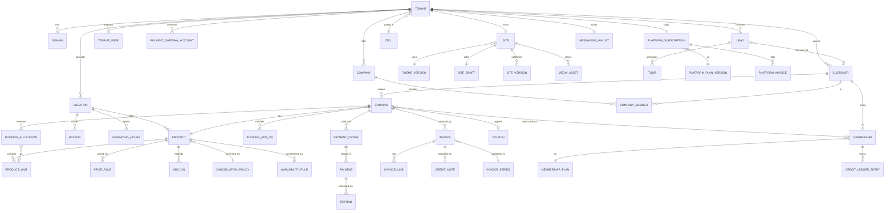

# 09 · Data Model

> Cowos requirements pack · v0.1 draft · Logical model for PostgreSQL. All tenant-owned tables carry `tenant_id` (RLS-enforced). IDs are UUIDv7. Timestamps `timestamptz` in UTC. Money as `numeric(12,2)` in INR with `currency char(3)` for future markets.

## 1. Entity overview by module

| Module | Entities |
|--------|----------|
| Tenancy | Tenant, TenantSettings, TenantStateHistory, Cell (tenant catalog) |
| Identity | TenantUser, TenantUserRole, TenantUserLocation, Customer, CustomerIdentity (phone/email), OtpChallenge, PlatformUser |
| Sites | Theme, ThemeVersion, Site, SiteDraft, SiteVersion, Page, MediaAsset, MediaVariant |
| Domains | Domain, DomainVerification, CertificateStatus |
| Inventory | Location, OperatingHours, Holiday, Amenity, LocationAmenity, Product, ProductUnit (Resource), PriceRule, AddOn, AvailabilityRule, MaintenanceBlock, TourSlotRule |
| Booking | Booking, BookingAllocation, BookingAddOn, BookingEvent, DayCapacityLedger, CheckIn |
| Policies | CancellationPolicy, CancellationTier, PolicyDocument |
| Payments | PaymentGatewayAccount, PaymentOrder, Payment, Refund, OfflinePayment, WebhookEvent |
| Invoicing | InvoiceSeries, Invoice, InvoiceLine, CreditNote, CreditNoteLine, TaxProfile |
| CRM | Company, CompanyMember, Lead, LeadActivity, Tour, Note, ConsentRecord, DataRightsRequest, SecurityDeposit |
| Memberships (P2) | MembershipPlan, Membership, CreditLedgerEntry |
| Promotions | Coupon, CouponRedemption |
| Notifications | NotificationTemplate, NotificationMessage, MessagingWallet, WalletTransaction |
| Platform billing | PlatformPlan, PlatformPlanVersion, PlatformSubscription, PlatformInvoice, PlatformPayment, UsageRecord |
| Audit & support | AuditEvent, SupportGrant, SupportTicketRef |

## 2. Core relationships



## 3. Key entities and attributes

### 3.1 Tenancy and identity

**Tenant**
| Field | Type | Notes |
|-------|------|-------|
| id | uuid | |
| slug | citext unique | Platform subdomain; reserved list enforced |
| brand_name, legal_name | text | |
| entity_type | enum | Proprietorship, Partnership, LLP, PvtLtd, Other |
| gstin | text null | Validated format + checksum; unique among active tenants |
| pan | text null | |
| state_code | char(2) | From GSTIN or address; drives tax |
| state | enum | Trial, Active, PastDue, Restricted, Suspended, SuspendedByAdmin, Expired, Cancelled, PendingDeletion, Deleted |
| trial_ends_at, state_changed_at | timestamptz | |
| goal | enum | FullSite, BookingOnly |
| cell_id | uuid | Tenant catalog (pool-1 by default) |
| kyc_status | enum | NotStarted, Pending, Verified, Rejected |
| first_publish_approved_at | timestamptz null | |
| referral_code, referred_by_code, utm | text / jsonb | |
| timezone | text | Default `Asia/Kolkata` |
| currency | char(3) | Default INR |

**TenantUser**: id, tenant_id, email (citext), phone, name, password_hash, mfa_secret (encrypted), mfa_enabled, role (Owner, Manager, Staff), status, last_login_at. **TenantUserLocation**: tenant_user_id, location_id (scope).

**Customer** (per tenant): id, tenant_id, name, phone_e164, email, gstin, billing_address (jsonb), marketing_consent (derived from latest ConsentRecord), status (Active, Blocked, Anonymised), created_via (Online, Staff, Import), last_activity_at. Unique (tenant_id, phone_e164) and (tenant_id, email) where not null.

**Company**: id, tenant_id, name, gstin, billing_address, admin_customer_id, credit_terms_days, notes. **CompanyMember**: company_id, customer_id, role (Admin, Member), can_bill_to_company.

**PlatformUser** (SSPL staff): id, idp_subject, email, role (SuperAdmin, Support, Finance), status.

### 3.2 Sites and domains

**Theme / ThemeVersion**: theme key, name, version (semver), package reference, content JSON schema, supported sections, plans allowed, status (Active, Deprecated).

**Site**: id, tenant_id, theme_version_id, live_version_id null, booking_placement (Subdomain, Path), branding (jsonb: logo asset ids, colours, font pair, button shape, mode).

**SiteDraft**: site_id, content (jsonb, theme-independent sections), updated_at, updated_by, revision (optimistic concurrency).

**SiteVersion** (immutable): id, site_id, number (int, increments), content snapshot (jsonb), branding snapshot, theme_version_id, status (Rendering, Live, Superseded, Failed), s3_prefix, published_by, published_at, note, rolled_back_from_version_id null.

**MediaAsset**: id, tenant_id, original_key, mime, width, height, bytes, alt_text, blurhash, scan_status, variants (jsonb), usage_count.

**Domain**: id, tenant_id, hostname (citext unique globally), purpose (Website, Booking, WebsiteAndBooking, Redirect), is_platform (bool), status (PendingDns, Verified, CertPending, Active, Degraded, Removed), verification_token, last_checked_at, dns_provider_detected, cert_expires_at, edge_tenant_ref.

### 3.3 Inventory

**Location**: id, tenant_id, name, slug, address (jsonb), lat, lng, directions, gst_registration_id (for multi-state), timezone, contact phone/email, is_24x7, status.

**OperatingHours**: location_id, day_of_week, opens_at, closes_at (multiple rows for split shifts). **Holiday**: location_id, date, name, closed_all_day or partial hours.

**Product** (what is sold)
| Field | Notes |
|-------|-------|
| id, tenant_id, location_id | |
| type | HotDesk, DedicatedDesk, PrivateCabin, MeetingRoom, EventSpace, VirtualOffice, Custom |
| inventory_model | Pool (capacity count) or Unit (specific resources) |
| name, slug, description, photos (media ids), amenities | |
| booking_mode | Instant, Request, Enquire |
| visibility | Public, MembersOnly, Hidden |
| capacity_per_unit | Seats (rooms/cabins) |
| pool_capacity | For Pool model (seats per day) |
| slot_granularity_min, min_duration_min, max_duration_min | |
| buffer_before_min, buffer_after_min, lead_time_min, advance_window_days | |
| tax: sac_code (default 997212), gst_rate (default 18.00), price_includes_tax | |
| cancellation_policy_id, request_sla_hours | |
| security_deposit_amount | Monthly products |
| convenience_fee_type, convenience_fee_value | Optional tenant fee (None, Flat, Percent); goes to the tenant |

**ProductUnit** (Resource): id, tenant_id, product_id, label ("Cabin 3", "D-12"), capacity, floor, zone, floor_plan_x/y (P2), status (Active, Maintenance, Retired).

**PriceRule**: id, product_id, unit (Hour, HalfDay, Day, Week, Month), amount, member_amount null, applies_to_unit_id null (unit-specific price), valid_from, valid_to, peak rules (P2: days_of_week, time window, multiplier).

**AddOn**: id, product_id, name, amount, basis (PerBooking, PerHour, PerPerson), max_qty, stock null.

**AvailabilityRule**: product_id or unit_id, days_of_week, start_time, end_time (overrides location hours). **MaintenanceBlock**: unit_id, during (tstzrange), reason.

**TourSlotRule**: location_id, days_of_week, start, end, slot_minutes, parallel_tours.

### 3.4 Booking

**Booking**
| Field | Notes |
|-------|-------|
| id, tenant_id, reference (human-readable, e.g. `WL-7K3D9`) | |
| customer_id, company_id null, bill_to (Customer, Company) | |
| product_id, location_id | |
| status | Requested, Held, AwaitingPayment, Confirmed, CheckedIn, Completed, Cancelled, NoShow, Expired, Declined |
| source | Online, Staff, Widget, Import |
| starts_at, ends_at | Customer-facing period |
| quantity | Seats (pool) |
| price_snapshot | jsonb: unit prices, add-ons, discounts, tax split, totals (frozen at booking) |
| subtotal, discount, taxable_value, tax_amount, total | |
| coupon_id, membership_id (credits) | |
| hold_expires_at | For Held |
| payment_link_expires_at | For AwaitingPayment |
| cancellation_policy_snapshot | jsonb (policy at time of booking applies, not current policy) |
| cancelled_at, cancelled_by, cancel_reason, refund_amount_policy, refund_amount_final | |
| notes_customer, notes_internal | |
| idempotency_key | Unique per tenant |

**BookingAllocation** (what is actually blocked)
| Field | Notes |
|-------|-------|
| id, tenant_id, booking_id | |
| unit_id | For Unit-model products |
| blocked_during | tstzrange including buffers |
| active | Boolean, true while booking status blocks inventory |

Double-booking prevention for unit products:

```sql
CREATE EXTENSION IF NOT EXISTS btree_gist;
ALTER TABLE booking_allocation
  ADD CONSTRAINT booking_allocation_no_overlap
  EXCLUDE USING gist (tenant_id WITH =, unit_id WITH =, blocked_during WITH &&)
  WHERE (active);
```

**DayCapacityLedger** (pool products): tenant_id, product_id, date, capacity, booked (int), with `CHECK (booked <= capacity)`. Holds increment `booked` in the same transaction (`UPDATE ... SET booked = booked + :qty WHERE booked + :qty <= capacity`), so overselling is impossible under concurrency.

**BookingEvent**: booking_id, type (Created, Held, PaymentStarted, Paid, Confirmed, Rescheduled, Cancelled, RefundIssued, CheckedIn, NoShow, NotificationSent), actor (customer/staff/system/support), data (jsonb), at.

**CheckIn**: booking_id, checked_in_at, method (QR, Manual, Self), by_user_id.

### 3.5 Policies

**CancellationPolicy**: id, tenant_id, name, product_type default, no_show_refund_pct, deduct_gateway_fee (bool), allow_credit_instead (bool), credit_bonus_pct, reschedule_allowed_until_hours, free_text. **CancellationTier**: policy_id, min_hours_before, refund_pct (ordered).

**PolicyDocument**: tenant_id, kind (Privacy, Terms, HouseRules, Refund), version, content, published_at.

### 3.6 Payments

**PaymentGatewayAccount**: id, tenant_id, provider (Razorpay, Cashfree, PhonePe), connection_type (OAuth, ApiKey), account_ref, display_name, mode (Test, Live), credentials_ciphertext (KMS envelope), token_expires_at, status (Connected, Error, Disconnected), last_health_check_at.

**PaymentOrder**: id, tenant_id, booking_id or invoice_id, gateway_account_id, provider_order_id, amount, status (Created, Attempted, Paid, Expired), idempotency_key.

**Payment**: id, tenant_id, order_id, provider_payment_id (unique), method (UPI, Card, Netbanking, Wallet, EMI), method_detail_masked, amount, fee, tax_on_fee, status (Authorized, Captured, Failed, Refunded, PartiallyRefunded), captured_at, raw (jsonb, no card data).

**OfflinePayment**: id, tenant_id, booking_id/invoice_id, method (Cash, UpiDirect, BankTransfer, Cheque), reference, amount, received_at, recorded_by.

**Refund**: id, tenant_id, payment_id null, booking_id, amount, destination (Original, Credit), provider_refund_id, status (Pending, Processed, Failed), reason, initiated_by, override (bool).

**WebhookEvent**: id, provider, provider_event_id (unique), tenant_id (resolved from account), type, signature_valid, payload (jsonb), received_at, processed_at, error.

### 3.7 Invoicing

**TaxProfile** (per tenant/location GST registration): gstin, legal name, address, state_code.

**InvoiceSeries**: id, tenant_id, location_id, kind (Invoice, CreditNote, BillOfSupply), prefix, financial_year ('2026-27'), next_number. Number allocation via `UPDATE ... RETURNING` in the invoice transaction (gap-free; max 16 characters total).

**Invoice**: id, tenant_id, series_id, number, issue_date, supplier snapshot (jsonb), buyer snapshot (name, address, GSTIN, state), place_of_supply_state, invoice_type (B2B, B2C, BillOfSupply), booking_id/membership_id, subtotal, discount, taxable_value, cgst, sgst, igst, total, amount_paid, status (Issued, PartiallyPaid, Paid, Void), pdf_key. Immutable after issue (only status and paid amounts change).

**InvoiceLine**: invoice_id, description, sac_code, quantity, unit, rate, discount, taxable_value, gst_rate, cgst, sgst, igst.

**CreditNote / CreditNoteLine**: same shape, references invoice_id, reason.

### 3.8 CRM and compliance

**Lead**: id, tenant_id, source (WebsiteForm, Enquiry, Tour, Walkin, Phone, Import, Widget), name, phone, email, company_name, interest_product_id, team_size, budget, move_in_date, stage (New, Contacted, TourScheduled, TourDone, Proposal, Won, Lost), lost_reason, owner_user_id, next_follow_up_at, customer_id (when converted). **LeadActivity**: lead_id, type (Call, WhatsApp, Email, Note, StageChange), data, by, at.

**Tour**: id, tenant_id, lead_id, location_id, scheduled_at, status (Scheduled, Done, NoShow, Cancelled), host_user_id.

**ConsentRecord**: id, tenant_id, customer_id or lead_id, purpose (Marketing_WhatsApp, Marketing_SMS, Marketing_Email, Analytics), granted (bool), notice_version, channel (Web, Staff, WhatsApp reply), captured_at, ip_hash.

**DataRightsRequest**: id, tenant_id, customer_id, type (Access, Correction, Erasure, Grievance, Nomination), status, due_at, handled_by, completed_at, notes.

**SecurityDeposit**: id, tenant_id, customer/company, booking/membership, amount, collected_via, status (Held, PartiallyRefunded, Refunded, Forfeited), deductions (jsonb).

### 3.9 Memberships (Phase 2) and promotions

**MembershipPlan**: id, tenant_id, location_id, name, price, cycle (Monthly, Quarterly, Annual), included_product_id, included_credit_minutes, credit_products (list), member_discount_pct, access_hours, deposit_amount, notice_days, rollover_cap_minutes, visibility.

**Membership**: id, tenant_id, plan_id, customer_id or company_id, assigned_unit_id, starts_on, current_cycle_start/end, status (Active, Paused, NoticeGiven, Ended), next_invoice_on.

**CreditLedgerEntry**: id, tenant_id, membership_id, change_minutes (+/−), reason (CycleGrant, BookingUse, Expiry, Adjustment, Refund), booking_id null, at. Balance = sum.

**Coupon** (tenant promo code): id, tenant_id, code (citext, unique per tenant), type (Percent, Flat), value, max_discount, min_order, valid_from/to, total_limit, per_customer_limit, product_ids, location_ids, first_booking_only, visibility (Public, Private), banner_text, status (Active, Paused, Expired, Archived), created_by. **CouponRedemption**: coupon_id, booking_id, customer_id, discount_amount.

### 3.10 Notifications

**NotificationTemplate**: id, tenant_id null (platform default), event, channel (Email, Sms, WhatsApp), locale, subject, body, provider_template_id (DLT/WhatsApp), category (Utility, Authentication, Marketing).

**NotificationMessage**: id, tenant_id, recipient (customer/user id + masked address), event, channel, template_id, status (Queued, Sent, Delivered, Read, Failed), provider_message_id, cost, error, related_entity, created_at.

**MessagingWallet**: tenant_id, balance. **WalletTransaction**: tenant_id, amount (+top-up / −usage), message_id null, platform_invoice_id null, at.

### 3.11 Platform billing

**PlatformPlan / PlatformPlanVersion**: plan key (Starter, Growth, Pro, Dedicated), version, monthly_price, annual_price, limits (jsonb: locations, resources, staff, custom_domains, pages), features (jsonb flags), effective_from.

**PlatformSubscription**: id, tenant_id, plan_version_id, cycle (Monthly, Annual), status (Trialing, Active, PastDue, Cancelled), current_period_start/end, cancel_at_period_end, gateway_subscription_id/mandate_ref, discount (jsonb).

**PlatformInvoice**: id, tenant_id, number (`CW/26-27/000123`), period, lines (plan, proration, wallet top-up), tax split by SSPL state vs tenant state, total, status, due_at, paid_at, pdf_key. **PlatformPayment**: invoice_id, provider ids, amount, status.

**UsageRecord**: tenant_id, metric (Messages, StorageGB, Bookings, ApiCalls), period, quantity (for cost-to-serve and plan limits; bookings never billed).

### 3.12 Audit and support

**AuditEvent** (append-only): id, tenant_id null (platform events), actor_type, actor_id, impersonated_by null, action (e.g. `pricing.updated`, `refund.override`), entity_type, entity_id, before (jsonb), after (jsonb), ip, user_agent, at. Partitioned by month.

**SupportGrant**: id, tenant_id, requested_by (platform user), ticket_ref, reason, access (ReadOnly, ReadWrite), status (Requested, Approved, Denied, Revoked, Expired), approved_by (tenant user), starts_at, expires_at.

## 4. Data rules and constraints

| Rule | Mechanism |
|------|-----------|
| No overlapping allocations on a unit | GiST exclusion constraint on `booking_allocation` |
| No overselling of pool capacity | Conditional update on `day_capacity_ledger` + CHECK |
| Invoices immutable after issue | No UPDATE of financial columns (trigger) except status/paid; corrections by credit note |
| Gap-free invoice numbers per series per FY | Row lock on `invoice_series` inside the invoice transaction |
| Webhook idempotency | Unique `(provider, provider_event_id)`; unique `provider_payment_id` |
| Booking creation idempotency | Unique `(tenant_id, idempotency_key)` |
| Policy at time of booking applies | `cancellation_policy_snapshot` on booking |
| Price at time of booking applies | `price_snapshot` on booking |
| Hostnames unique across platform | Unique index on `domain.hostname` where status ≠ Removed |
| Soft delete for configuration | `archived_at` on products, units, coupons, plans (referenced by history) |
| Hard delete / anonymise for personal data | Erasure job replaces personal fields with tokens; keeps financial records with masked buyer details unless law needs them |
